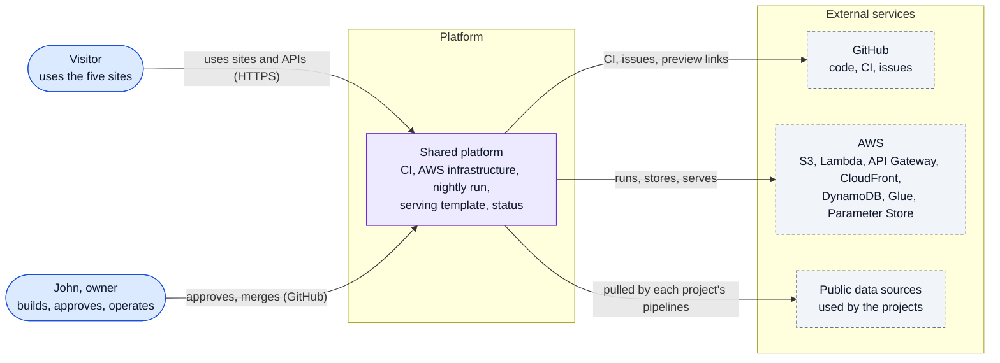
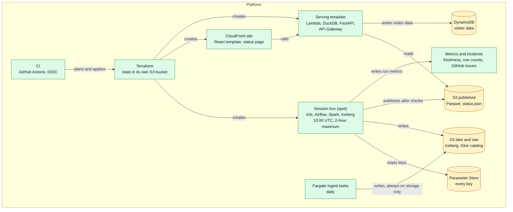
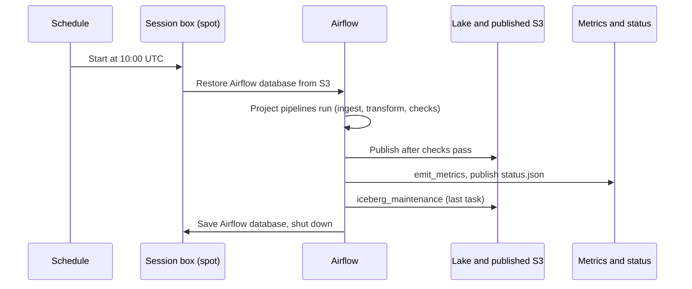
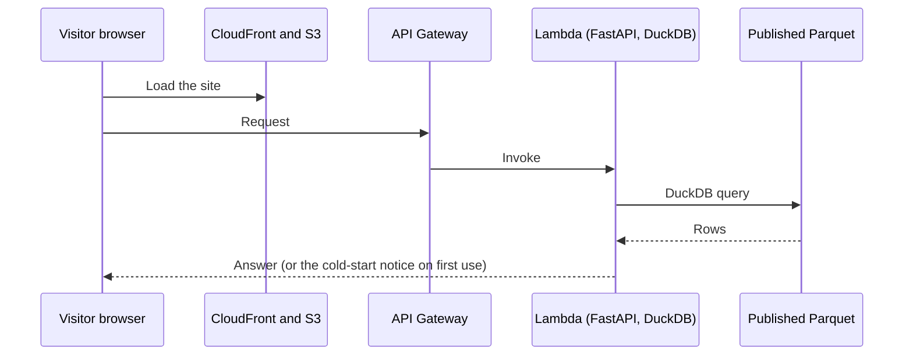

# Platform: design doc

Template: Google design doc, arc42 sections, C4 model [DP: Design doc template]. Citations: [BP x] is the build plan, step or section x; [BD x] is Build Plan Decisions; [DP x] is the Documentation Plan; [ADR-000n] is a decision record in [adrs/](adrs/); [Eng n] is engineering standard n in [requirements.md](requirements.md) section 2; [OQ-Pnn] is an open question in section 16. Requirement IDs (PR-nn, QR-nn) are in [requirements.md](requirements.md).

Names of tables, buckets, functions and files in this document are proposed here and become binding when John approves this document.

---

## 1 Status, owner, reviewers, last updated

| Field | Value |
|---|---|
| Status | Draft, awaiting John's review and approval before platform coding begins |
| Scope | Shared by all five projects (Projects 1 to 5). Not Project 4's own documents. |
| Owner | John (GitHub: jwasikye) |
| Reviewers | John (approves each platform document) [DP: How the documents get drafted] |
| Last updated | Oct 9, 2026 |
| Build position | Written first. Built before Project 1 (walking skeleton, steps 0.1 to 0.5), then operations hardening in step 1B.9 [BP Order] |

## 2 Summary

The platform is the shared base for the five projects. It is a public repository with CI, Terraform-built AWS infrastructure, a nightly computer (the session box) that is started each night on spot pricing, runs Airflow and Spark on k3s, publishes Parquet to S3, and shuts down. Public pages and small APIs run on CloudFront, S3 and Lambda, so they stay up with the session box off. Every key is in Parameter Store. Dev and live are separate copies built from the same code. Freshness, row counts, a status page, and one incident record per real failure show whether the data is good [BP Platform skeleton; BP How the plan works].

The platform's rules, not its code, are what the projects rely on: cost guards, storage clean-up and locks, UTC timestamps, least privilege, and the sixteen engineering standards [requirements.md](requirements.md) section 2.

## 3 Context, scope and constraints

### 3.1 Background facts

| Fact | Source |
|---|---|
| Budget under $50 a month, browser only. Normal month about $23 to $46 on spot pricing; prices as of Oct 8, 2026 | BD Budget; BP Operating model |
| Nightly run at 10:00 UTC (3 a.m. Arizona, 6 a.m. US Eastern), about 45 minutes expected, 2 hours maximum, spot only | BD Data freshness; BD Nightly run time; BP How the box is run |
| A $40 AWS budget denies new launches and stops the box; budget alerts lag by hours, so the idle alarm and session limit are the real guards | BP 0.3 guardrails; BD Cost guards |
| Live raw files locked 30 days (governance mode); dev files not locked | BP Engineering table; BD Raw-file lock |
| Dev and live fully separate; dev cannot write live | BD Dev and live; BP 0.2 |
| Parameter Store holds every key; GitHub stores none | BD Key storage; BP Tools table |
| Visitor data in DynamoDB; point-in-time recovery on by default | BD Visitor data; BD DynamoDB |
| Terraform (not OpenTofu); state in a dedicated bucket | BD Terraform vs OpenTofu; BD Terraform state |
| Kubernetes via k3s, not Docker Compose | BD Kubernetes over Docker Compose; BP 0.3 |
| Container images on ARM; Marquez builds once, pinned | BD Container images on ARM; BD Lineage graph |

### 3.2 System boundary

Inside the platform: the repository and CI, the Terraform modules, the session box and its schedule, Airflow and Spark on k3s, the Iceberg tables and the Glue catalog, the publish step, the serving template (Lambda, API Gateway, DuckDB, FastAPI), the React site template, the status page and status.json, the metrics table and incident records, the storage rules, and the budget and limits.

Outside (owned by each project): each project's pipelines, data models, contracts for its own sources, and its pages. Outside the platform's own scope: the on-call agent (second round).

### 3.3 Constraints

- Under $50 a month, browser only [BD Budget].
- Every paid item has a hard limit [BD Surprise costs; BP Hard limits table].
- Non-commercial portfolio use [BP Assumptions].
- Timestamps in UTC [BD Timestamps].
- Stack fixed by the build plan's Tools table: Airflow, Spark, Iceberg with Glue, DuckDB serving, dbt, Great Expectations, React, FastAPI, API Gateway, Terraform, Docker, k3s, GitHub Actions, Parameter Store, DynamoDB [BP Tools table].

## 4 Goals and non-goals

### Goals

- G1. Build the five projects from documents, on one shared base, without re-deciding shared parts [DP Purpose].
- G2. Nothing surprises on cost; everything is destroyable [BD Surprise costs; Eng 10].
- G3. Pages and small APIs answer with the session box off [Eng 16].
- G4. Data is fresh every night; bad data never publishes [Eng 4, 11].
- G5. Dev and live cannot damage each other [BD Dev and live].
- G6. Every change is tested before it reaches live, with a preview link for every site change [BP How the plan works].

### Non-goals

- No always-on server. A small always-on server would break the budget [BD Always-on parts].
- No query engines that duplicate DuckDB or Snowflake (Trino, Flink, BigQuery, pgvector and DataHub are removed) [BD Duplicate engines].
- No OpenTofu, no Docker Compose, no keys in GitHub [BD Terraform vs OpenTofu; BD Kubernetes; BD Key storage].
- No backfills in the nightly run [BD Backfills].

## 5 Requirements

Full text: [requirements.md](requirements.md). Summary:

- Skeleton: PR-01 to PR-15 (steps 0.1 to 0.5 and the hard limits).
- Operations hardening: PR-20 to PR-24 (step 1B.9).
- Rules every project inherits: PR-30 to PR-36.
- Quality: QR-01 to QR-10.
- Acceptance: the build plan's "Done when" for steps 0.1 to 0.5 and 1B.9, plus the skeleton's first-run checks.

## 6 Architecture

### 6.1 System context (C4 level 1)

### 6.2 Containers (C4 level 2)

### 6.3 Components of the session box (C4 level 3)

```mermaid
flowchart LR
  sched["`Schedule
starts the box 10:00 UTC`"]:::cont
  start["`Start and guards
4-hour session limit,
idle alarm, spot handler`"]:::cont
  restore["`Restore
Airflow database from S3,
keys from Parameter Store`"]:::cont
  airflow["`Airflow
DAGs, retries, backfill`"]:::cont
  spark["`Spark jobs
row and runtime limits`"]:::cont
  checks["`Checks
Great Expectations, dbt tests`"]:::cont
  publish["`Publish
Parquet to published S3`"]:::cont
  metrics["`Run metrics
freshness, row counts`"]:::cont
  maint["`Iceberg maintenance
last task`"]:::cont
  save["`Save and stop
Airflow database to S3, box off`"]:::cont
  sched --> start --> restore --> airflow
  airflow --> spark --> checks --> publish
  publish --> metrics --> maint --> save
  classDef cont fill:#dcfce7,stroke:#15803d,color:#0f172a
```

### 6.4 Repository structure

One public repository with the folders platform (Terraform and platform code), pipelines, dbt, checks, app and docs [BP 0.1]. Each project puts its code in a subfolder named after the project inside each folder.

## 7 Component breakdown

Function, class, file and table names here are proposals. They become binding when John approves this document. Types are written Python-style and are descriptive.

### 7.1 Repository and CI: .github/workflows/

- Job: run lint and tests on every push, Terraform plan on pull requests, apply after approval, gitleaks and Trivy scans, and the changed pipelines on sample data (no AWS session box) [BP 0.1; BP How the plan works].
- Inputs: pushes, pull requests, approvals.
- Outputs: check results, plan output, deploys to dev, then to live after a merge to main.
- Main items: workflows `ci.yml` (lint, tests, gitleaks, Trivy), `terraform.yml` (plan on pull request, apply after approval), `deploy.yml` (dev, then live); OIDC role assumption (ADR-0007).
- Dev container: a Codespaces configuration (`.devcontainer/devcontainer.json`) with the tools for the repository [BP 0.1].

### 7.2 Terraform modules: Platform/terraform/

- Job: create every AWS resource as code and destroy them cheaply [Eng 10].
- Modules (proposed): `state` (the state bucket with versioning, KMS, public-access block, S3 locking; created once by hand and then referenced), `storage` (raw, lake and site buckets with the clean-up rules and Object Lock on live raw), `catalog` (Glue databases, one per environment), `site` (CloudFront and the site bucket), `budget` ($40 budget and action), `iam` (one least-privilege role per pipeline and the OIDC trust), `parameters` (Parameter Store paths), `session_box` (spot instance module, schedule, session limit, idle alarm, spot handler), `serving` (Lambda, API Gateway HTTP API, and REST API where keys are needed), `visitor_data` (DynamoDB tables, point-in-time recovery).
- Inputs: environment name (dev or live), tags.
- Outputs: resource names and ARNs read by the pipelines.
- Rule: a module that creates a live resource cannot be applied from a dev role (ADR-0020).

### 7.3 Session box: Platform/box/

- Job: start a spot instance with k3s, install Airflow and Spark with their official Helm charts, run the nightly DAG, and shut down [BP 0.3].
- Inputs: the schedule (10:00 UTC), the Airflow database backup in S3, Parameter Store paths.
- Outputs: pipeline results in S3, metrics, the shutdown.
- Main items:
  - `start_box(env) -> InstanceId` (Terraform-driven; the box starts from the schedule or by hand).
  - `restore_airflow_db(s3_uri)` and `save_airflow_db(s3_uri)`: the database is saved after every run and at shutdown, and restored at startup (ADR-0008).
  - `on_spot_interruption(event)`: reacts to the two-minute warning; the running tasks are safe to rerun [BP How the box is run].
  - `enforce_session_limit(max_hours=4)`, `idle_alarm(idle_minutes)`: the 4-hour session limit and idle shutdown [BD Cost guards].
  - `shutdown_when_done()`: stops the box when the DAG run ends, or at the 2-hour nightly maximum, and records a reached maximum as an incident [BD Nightly shutdown].
- Notes: the nightly run uses spot only. If spot is unavailable, the night is skipped and the next run catches up (ADR-0012). Sizes: t4g.2xlarge for everyday work, m7g.2xlarge for heavy batch [BP Where each job runs].

### 7.4 Airflow DAG conventions: pipelines/Platform/dags/

- Job: give every project a shared DAG pattern: a schedule, a data interval, task retries, and the platform's finishing tasks [Eng 3, 7, 11].
- Standard finishing tasks, in order: `publish_gate` (from the project), `publish`, `emit_metrics`, `iceberg_maintenance` (last, always) [Eng 7].
- Functions: `emit_on_failure(context)` (opens an incident and a GitHub issue), `data_interval_to_partition(logical_date) -> partition` (rules from Eng 3).

### 7.5 Iceberg and Glue: Platform/lake/

- Job: store every lake table as Iceberg on S3, registered in the Glue catalog, one database per environment [BP Tools table; BP 0.2].
- Maintenance job `iceberg_maintenance(table_list)`: compacts small files, expires snapshots older than a set retention, and removes orphan files, as the last task of the nightly run [Eng 7]. The retention values are open (OQ-P07).

### 7.6 Publish step and serving template: Platform/serving/

- Job: write gold tables as Parquet, and serve them through Lambda running DuckDB behind API Gateway and FastAPI [BP 0.4; BD Serving queries].
- Main items: `publish_parquet(tables, gate_result)` (refuses unless `gate_result` passed), `app = FastAPI()` with `/health` and the sample route (see [openapi-serving-template.yaml](openapi-serving-template.yaml)), `duckdb_query(parquet_glob, sql)`.
- Cold-start notice text is fixed by PR-12.

### 7.7 Site template: Platform/site/ (React and TypeScript)

- Job: a site template with a map component, a lookup form, an answer card and a status page, and a preview deploy for every pull request [BP 0.4].
- Components (proposed): `MapView`, `LookupForm`, `AnswerCard`, `StatusPage` (reads status.json), `ColdStartNotice`, `LateNotice` (always shown when the data is late, with the time of the last good run).
- Preview deploys: each pull request gets its own preview link before merge (mechanism open, OQ-P05).

### 7.8 Status and metrics: Platform/ops/

- Job: write freshness and row counts for every task, publish status.json for the status page, and turn failures into one incident record and one GitHub issue [BP 0.5; BP 1B.9].
- Main functions: `emit_run_metrics(run_id, dag_id, task_id, rows_read, rows_written, freshest_event_time_utc, status)` writes the platform_run_metrics table (contract [contracts/platform_run_metrics.yaml](contracts/platform_run_metrics.yaml)); `publish_status(now_utc) -> status.json` writes the file that the status page reads (contract [contracts/status_json.yaml](contracts/status_json.yaml)); `open_incident(event) -> incident_id` writes a record (contract [contracts/platform_incidents.yaml](contracts/platform_incidents.yaml)); `open_github_issue(incident)` de-duplicates on the pipeline and the failure type and closes on recovery [BP 1B.9].
- Email: a failed run or missed freshness target sends an email through an SNS topic (Default, ADR-0024).
- Freshness rule: a pipeline is "late" when its last good run is older than its freshness target, which each project sets (OQ-P08).

### 7.9 Parameter Store and keys: Platform/keys/

- Job: hold every key in Parameter Store (SecureString), read through IAM roles and OIDC, with each read logged [BP Tools table; BD Key storage].
- Path convention (proposed): `/portfolio/<env>/<project>/<name>`. The `<env>` segment is `dev` or `live`.
- Airflow reads its connection keys through its secrets backend, so the Airflow database backup holds no key [BP 0.3].

### 7.10 Visitor data: Platform/visitor/

- Job: DynamoDB tables for visitor data (signal reports, votes, email sign-ups, API key requests, review queue) [BP Tools table].
- Settings: provisioned capacity within the free tier, so heavy traffic is throttled rather than billed; point-in-time recovery on by default (PR-34, ADR-0006).
- Personal data: email addresses stay in DynamoDB and appear elsewhere only as a keyed-hash code [BD Email addresses].

### 7.11 Observability and tracing: Platform/observability/

- Job: CloudWatch alarms (idle box, storage size, budget), X-Ray traces for AI and API calls where a project uses them, and CloudTrail (security logs kept one year, including Parameter Store reads) [BP Tools table; BD Storage clean-up].
- Fargate ingest tasks write only to always-on storage (S3, DynamoDB, CloudWatch, X-Ray) [Eng 16].

### 7.12 Data lineage: Platform/lineage/

- Job: OpenLineage events from Airflow and Spark to Marquez, plus the dbt docs site [BP Tools table].
- Marquez images are built once for ARM in GitHub Actions, pinned to one version, and rebuilt only when an upgrade is chosen [BD Lineage graph; ADR-0010].

## 8 Runtime view

### 8.1 Nightly run (10:00 UTC)

Steps and failure handling:

1. The box starts on spot at 10:00 UTC. If no spot instance is available, the start retries for up to 2 hours (until 12:00 UTC), then the night is skipped and the next run catches up [BP How the box is run; ADR-0012].
2. The box restores the Airflow database from S3 and reads keys from Parameter Store [PR-10].
3. Each project's pipelines run. A failing task retries as the project's DAG defines, then fails. A failure opens one incident and one GitHub issue, and sends an email [PR-14, PR-24].
4. Publishing happens only after the checks pass. A failed check stops the publish and opens an incident [Eng 4].
5. Run metrics are written and status.json is published, so the status page shows the last good run [PR-13].
6. Iceberg maintenance runs last [Eng 7].
7. The box saves the Airflow database and shuts down when the pipelines finish. Reaching the 2-hour maximum is recorded as an incident [BD Nightly shutdown].
8. If AWS takes back the spot instance, the interruption handler reacts to the two-minute warning. Every task is safe to rerun [BP How the box is run].

### 8.2 Public request with the box off

A first request after inactivity may take up to 10 seconds, and the page says so [PR-12]. The request reads published files only, so it works with the box off [Eng 16].

### 8.3 Deploy flow

On every merge to main, GitHub Actions runs the changed pipelines on sample data. Only if they pass does the change deploy to dev, then to live. Every site change gets a preview link [BP How the plan works].

## 9 Data model

Shared tables are in [contracts/](contracts/), in ODCS format. Project tables are in each project's contracts.

| Table | Layer | Contract | Notes |
|---|---|---|---|
| platform_run_metrics | Iceberg (lake) | [platform_run_metrics.yaml](contracts/platform_run_metrics.yaml) | One row per task run; freshness and row counts [PR-13; ADR-0024] |
| platform_incidents | Iceberg (lake) | [platform_incidents.yaml](contracts/platform_incidents.yaml) | One row per real incident: what broke, cause, fix [PR-14] |
| status.json | Published file (S3) | [status_json.yaml](contracts/status_json.yaml) | The file the status page reads; refreshed after each run [PR-13] |
| usage_events | Always-on arrival store, then Iceberg (lake) | [usage_events.yaml](contracts/usage_events.yaml) | One row per page view or action, in one format for every site; no IP address (ADR-0025) |
| Airflow database backup | S3 object | not a data table | Holds no keys [PR-10] |
| Visitor data | DynamoDB | each project's contract | Point-in-time recovery on by default [PR-34] |

## 10 API

Specification: [openapi-serving-template.yaml](openapi-serving-template.yaml). It is the template each project copies: `GET /health` and a sample route. Projects add their own paths in their own specifications.

API type: the HTTP type of API Gateway for public pages; the REST type only where API keys and per-key limits are needed [BP Tools table; BD Public API]. Rate limits and throttle values are open (OQ-P09).

## 11 Deployment view

| What | Runs where | Notes |
|---|---|---|
| Pipelines, Spark, Airflow, checks | Session box on k3s (t4g.2xlarge everyday; m7g.2xlarge for heavy batch), spot only | Started 10:00 UTC; shut down when done; 4-hour session limit; 2-hour nightly maximum [BP 0.3] |
| Ingest tasks | Fargate scheduled tasks, daily | Always-on storage only [Eng 16] |
| Serving | Lambda (FastAPI, DuckDB) behind API Gateway; site on CloudFront and S3 | Works with the box off [BP 0.4] |
| Published data, lake | S3 with Iceberg and the Glue catalog | Dev and live fully separate buckets, databases and roles [BP 0.2] |
| Visitor data | DynamoDB, one table per environment | Within the free tier [BD DynamoDB] |
| Keys | Parameter Store, one path per environment | Read through roles and OIDC [BD Key storage] |
| CI and deploys | GitHub Actions with OIDC | Tests on sample data; then dev; then live [BD Testing changes] |
| Editing, small tests | GitHub Codespaces | Free up to 120 core-hours a month [BP Where each job runs] |
| Infrastructure | Terraform; state in the platform's state bucket | [BD Terraform state] |

Environments: dev and live are separate in buckets, Glue databases, DynamoDB tables and roles. Dev roles cannot write live data [BP 0.2]. Schedules: nightly 10:00 UTC; weekly smoke test of sources (1B.9); storage clean-up daily.

## 12 Cross-cutting concerns

### 12.1 Security

- Least privilege: one role per pipeline, read-only where possible; dev roles cannot write live data [Eng 13; BP 0.2].
- Every key in Parameter Store; none in code or GitHub; GitHub reads them through OIDC [BD Key storage].
- Images scanned (Trivy) and secrets scanned (gitleaks) in CI [BP 0.1].
- Source text is treated as data, never as instructions, which matters for any page that holds text from a source [Eng 13].
- Agents (second round): read-only tools plus comments and draft pull requests; nothing merges without John's review [BD On-call agent permissions].
- The threat model is written while building (security and privacy document).

### 12.2 Privacy

- Timestamps in UTC; converted only on the page [BD Timestamps].
- Exact locations stay on the phone; the phone converts them to an H3 cell [BD Personal data].
- Email addresses only in DynamoDB; elsewhere a keyed-hash code [BD Email addresses].
- Raw reports expire 30 days after copying, for projects that collect them [BD Personal data].
- The personal-data inventory and deletion periods are written while building.

### 12.3 Observability

- Freshness and row counts per run; status page; email on a missed freshness target or failed run; one incident record per real incident; one de-duplicated GitHub issue per failure [BP 0.5, 1B.9; Eng 11].
- OpenLineage and the dbt docs catalog [BP Tools table].
- CloudTrail security logs kept one year [BD Storage clean-up].

### 12.4 Licensing

Platform use of third-party software: Airflow, Spark, Iceberg, k3s, Terraform, Marquez and the React template are open source and used under their own licences. Each project's data licences are in its own register. The platform's licence register is written while building.

### 12.5 Cost limits

| What can cost money | Hard limit [BP Hard limits table] |
|---|---|
| Each Spark job | A maximum number of rows read and written and a maximum runtime; stops before publishing and opens an incident |
| Servers | 4-hour session limit, idle shutdown, 2-hour nightly maximum |
| GPU (Project 5) | A maximum number of GPU hours per run; spot only |
| Snowflake | 3 credits a month and a time limit on every query |
| Public API | A cap on running copies, plus per-key quotas (Project 5) |
| AI model | $10 a month (Project 1, ADR 0038; the build plan had $15), a daily question cap and a token limit per answer |
| S3 storage | The clean-up rules, plus an alarm if storage passes a set size |
| DynamoDB | Provisioned within the free tier, so heavy traffic is throttled |
| Everything on AWS | The $40 budget, as a backup |

Monthly estimate (prices as of Oct 8, 2026; estimates from public price pages) [BP Monthly cost]:

| Item | Spot | On-demand |
|---|---|---|
| AWS total | $18 to $25 | About $37 |
| Snowflake after the trial (3-credit monitor) | Up to $6 | Up to $6 |
| Model API (cheapest model, $10 cap, Project 1 ADR 0038) | $5 to $10 | $5 |
| All in, normal month | About $23 to $46 | About $45 to $48 |

### 12.6 Reliability

Four measures: idempotent partition overwrite (Eng 3), write-audit-publish (Eng 4), the spot interruption handler, and Iceberg maintenance as the last task (Eng 7). Every job is safe to rerun.

### 12.7 Time zones

Stored in UTC; converted only on the page [Eng 15]. The nightly run is scheduled in UTC.

## 13 Testing strategy

| Level | What | Where |
|---|---|---|
| Unit | Shared functions (partition rules, status logic, metric writers) with fixed inputs | CI |
| Pipeline | Changed pipelines on sample files, with Spark on GitHub's free CI machines; the box stays off | CI [BD Testing changes] |
| Idempotence | A rerun gives the same rows | CI |
| Data tests | dbt tests on keys; Great Expectations suites with a passing and a failing sample | CI |
| Limits | A job given a limit below its input stops before publishing | CI |
| Infrastructure | `terraform plan` on pull requests; apply after approval; a dev role refused on live writes | CI |
| Teardown | `terraform destroy` leaves nothing billing | Skeleton gate [BP Platform skeleton] |
| Box | One command brings the box up; sample Spark job writes an Iceberg table; nightly schedule runs; teardown and restore | Skeleton gate |
| Site | The site is live; the sample endpoint answers with the box off | After each deploy |
| First-run checks | Image ARM runs; Airflow database restore; memory on the 32 GB box; session limit and idle shutdown | Skeleton (see requirements.md section 5) |
| Weekly | Source smoke test | Scheduled (1B.9) |

Evals, an LLM judge and red-team sets do not apply to the platform, except for the on-call agent in the second round.

## 14 Alternatives considered

| Decision | Options weighed | Record |
|---|---|---|
| Infrastructure as code | Terraform (chosen) vs OpenTofu | [ADR-0023](decisions.md) |
| Local cluster | k3s (chosen) vs Docker Compose | [ADR-0002](adrs/0002-k3s-on-the-session-box.md) |
| Keys | Parameter Store only (chosen) vs keys in GitHub | [ADR-0007](adrs/0007-keys-in-parameter-store.md) |
| Environments | Fully separate dev and live (chosen) | [ADR-0020](adrs/0020-dev-and-live-separate-merges-gated.md) |
| Nightly compute | Spot box started per night (chosen) vs always-on server | [ADR-0012](adrs/0012-nightly-run-spot-with-two-hour-maximum.md) |
| Airflow database | On the box, saved to S3 (chosen) vs PostgreSQL always on | [ADR-0008](adrs/0008-airflow-database-saved-to-s3.md) |
| Always-on parts | Lambda and Fargate on always-on storage only (chosen) | [ADR-0011](adrs/0011-always-on-writes-only-to-always-on-storage.md) |
| Visitor data | DynamoDB (chosen) vs PostgreSQL on the box | [ADR-0006](adrs/0006-dynamodb-for-visitor-data.md) |
| Storage rules | Clean-up schedule and 30-day Object Lock on live raw (chosen) | [ADR-0019](adrs/0019-raw-data-immutable-and-storage-rules.md) |
| Cost guards | Hard limits everywhere; session limit and idle shutdown as main guards; $40 budget as backup (chosen) | [ADR-0013](adrs/0013-cost-guards-and-spend-limits.md) |
| Serving | DuckDB in Lambda behind API Gateway (chosen) vs a cluster engine | [ADR-0026](adrs/0026-serving-template-and-cold-start-notice.md) |
| Container images | ARM images; one pinned Marquez build (chosen) | [ADR-0031](decisions.md), [ADR-0010](adrs/0010-openlineage-marquez-pinned-arm-build.md) |
| Time | UTC storage, local time on the page (chosen) | [ADR-0021](decisions.md) |
| Monitoring | Metrics table, status.json, email, GitHub issue (chosen) | [ADR-0024](adrs/0024-status-and-incidents.md) |
| Hashes | SHA-256 (Default) | [ADR-0032](decisions.md) |
| Tools | Duplicate engines removed (chosen) | [ADR-0001](adrs/0001-walking-skeleton-and-one-tool-per-job.md) |

### Minor decisions folded from ADRs

These were separate ADRs and are recorded here in full because each is a setting, a wording rule, a format or a repeat of a platform rule. The old numbers are kept so references still resolve.

| Old ADR | Decision | Detail |
|---|---|---|
| ADR-0003 | Use Terraform, not OpenTofu | Use Terraform. John's reason: it is the name employers recognize. |
| ADR-0015 | Agent traces go to AWS X-Ray; every model call is logged to S3 | Traces use OpenTelemetry and are sent to AWS X-Ray, which is always on and free for the first 100,000 traces a month (BP, "Where each job runs"). Every model call is written to the call log in S3, with the model, prompt version, tokens, latency and cost (contracts/llm_calls.yaml). The nightly run loads the call log into the lake. |
| ADR-0016 | Vector search uses LanceDB files in S3; pgvector is removed | Use LanceDB files in S3. Lambda searches them without the box. pgvector is removed as a duplicate. |
| ADR-0021 | Every timestamp is stored in UTC and converted to local time only on the page | Pipelines, tables, APIs and logs store every timestamp in UTC. The web page converts to the reader's local time. Sources whose time zone is unknown are flagged in their contract until it is confirmed (for example Project 5's tape times, an open question in that project). |
| ADR-0022 | Public pages use the API Gateway HTTP type; routes that need API keys and per-key limits use the REST type | Public pages and public data routes use the HTTP type (the public pages of each project). A route that needs keys or per-key quotas uses the REST type (a project that issues keys, such as Project 5's developer API, once decided in that project). The FastAPI app on Lambda is the same for both (ADR-0026). |
| ADR-0023 | Terraform state is in its own S3 bucket: versioned, encrypted with a customer-managed KMS key, public access blocked, readable only by the Terraform role, with S3 locking | A dedicated S3 bucket holds the state. It is versioned, encrypted with John's own KMS key, public access is blocked, and only the Terraform role can read it. Terraform's built-in S3 locking is on, so two runs cannot collide. The state is never committed to the repository. |
| ADR-0029 | Each source has an H3 resolution chosen from its data; joins use cell_to_parent to the coarser resolution | The resolution is the cell just larger than the source's pixel: resolution 9 for FCC files and hiker reports, 8 for the 15 arc-second rasters and Ookla tiles, and 4 for the 0.25 degree weather grids (BP rule 9). Joins across sources go to the coarser resolution with `cell_to_parent`. The phone converts GPS to an H3 cell about 350 m across. Exact coordinates never leave the phone (BPD, "Report location"). |
| ADR-0031 | Container images run on ARM | Every container image the platform runs is an arm64 image. Each image's manifest is checked before its first use. The one exception is Marquez, which is built once for ARM in GitHub Actions and pinned (ADR-0010). |
| ADR-0032 | SHA-256 is the hash for every content hash | Use SHA-256 for every content hash: raw file manifests, the source snapshots in every project, and the manifests for static archives (ADR-0019). |

## 15 Risks

| Risk | Handling |
|---|---|
| Spend rises above $50 a month | Hard limits per item; session limit; idle alarm; $40 budget (as backup); monthly estimate reviewed |
| The session box runs past 2 hours | Hard maximum; the box shuts down; the hit is an incident [BD Nightly shutdown] |
| Spot capacity is unavailable | The night is skipped and the next run catches up; the page shows the late notice (project decision) |
| A key leaks | Parameter Store only; gitleaks in CI; reads logged |
| A dev change damages live data | Separate buckets, catalogs and roles; dev roles refused on live writes |
| A failed run goes unnoticed | Email on failure and on missed freshness; status page; GitHub issue |
| The stack does not fit in 32 GB of memory | First-run check; OQ-P04; fallback is a smaller model or a bigger box within the budget (to be decided) |
| The ARM Marquez build fails | First-run check; OQ-P03; fallback is an x86 build run by hand (to be decided) |
| The GPU quota is not approved | Request in step 0.1; CPU fallback for Project 5 [BD GPU access] |
| An upstream source changes format | Weekly smoke test; contract diff before loading (Eng 5) |
| Terraform state is lost or corrupted | Versioned, KMS-encrypted bucket with locking; never in the repository |
| A project's Parameter Store path is misnamed | Path convention (section 7.9); CI check of the path list (`checks/parameter_paths.py`, OQ-P10) |

## 16 Open questions

Each question has a matching GitHub issue (placeholder "issue: to be created"). Answered questions stay in this table, with the answer and its ADR number, so existing references still resolve.

| ID | Question | Type | Blocks | What answering it needs |
|---|---|---|---|---|
| OQ-P01 | **Answered (John, Oct 9, 2026): both defaults in ADR-0024 approved (SNS email; metrics table in the lake). ADR-0032 (SHA-256) approved too.** Approve the defaults in ADR-0024: email through an SNS topic, and the metrics table as an Iceberg table in the lake. | Approval | PR-13, PR-14, PR-24 | Closed |
| OQ-P02 | **Partly answered (John, Oct 9, 2026): the 4-hour session limit and the 2-hour nightly maximum are approved as written. Still open: the idle-alarm duration, set after measurement.** | Decision and spike | PR-09 | Idle-alarm duration, from the first test run |
| OQ-P03 | Does the ARM build of the pinned Marquez version succeed, and does it run on the box? | Spike | Lineage (ADR-0010) | The build in GitHub Actions (Project 1 Phase B) |
| OQ-P04 | Does the full stack (Airflow, Spark, Kafka, Superset, PostgreSQL, Grafana) fit in 32 GB of memory on the box? | Spike | Box sizing (ADR-0012) | The stack running on the box |
| OQ-P05 | How do preview deploys get a link for each pull request: a path prefix in the site bucket, a separate CloudFront distribution, or another method? | Decision | PR-12 | John's choice, with a cost check |
| OQ-P06 | How many Airflow database backups are kept in S3, and for how long? | Decision | PR-10 | John's choice (default: latest plus one previous copy) |
| OQ-P07 | Iceberg maintenance values: snapshot retention and orphan-file age. | Decision | Eng 7 | John's choice, after the first table sizes are measured |
| OQ-P08 | Freshness targets and the status rule: is "late" the age of the last good run against each project's target, and how does status.json show it? | Decision | PR-13, QR-03 | John's choice |
| OQ-P09 | API throttle values and per-key quotas for the REST type (Project 5) and HTTP type (other projects). | Decision | Section 10 | Project design |
| OQ-P10 | **Answered (John, Oct 22, 2026): built with the platform skeleton.** Every path is listed in `checks/parameter_paths.yaml`; `checks/parameter_paths.py` checks the naming convention and the list against the code in CI, and the pull request plan checks that each listed parameter exists. A CI check that every Parameter Store path a project uses exists and follows the naming convention. Include it in step 0.1 or later? | Decision | Section 15 | Closed |

Spikes that gate the skeleton: OQ-P02 (measured idle time), OQ-P04. Spikes that gate Project 1 Phase B: OQ-P03.

## 17 Glossary

| Term | Meaning |
|---|---|
| Walking skeleton | A tiny version of the whole system with every main part connected end to end, grown while it keeps running [BD Build method] |
| Session box | The temporary AWS computer (a spot instance) that runs k3s, Airflow and Spark each night |
| Spot instance | A cheaper AWS computer that AWS can take back with a two-minute warning |
| k3s | A lightweight Kubernetes |
| Airflow | The scheduler that runs pipelines in order and retries them |
| Spark | The engine that runs the large data jobs |
| Iceberg | A table format on S3, registered in the Glue catalog |
| Glue catalog | AWS's table registry used by Iceberg and by Snowflake |
| DuckDB | The embedded query engine used for serving |
| Lambda | AWS service that runs code without a server |
| API Gateway | AWS service that exposes Lambda over HTTP (HTTP type for public pages, REST type for keys) |
| CloudFront | AWS service that serves the site's files worldwide |
| Parameter Store | AWS Systems Manager service that holds every key, encrypted |
| OIDC | OpenID Connect; lets GitHub Actions get short-lived AWS access without stored keys |
| Terraform | A tool that creates cloud resources from code |
| Object Lock | An S3 setting that blocks deletion or overwrite of a file for a set time |
| Point-in-time recovery | DynamoDB's ability to restore a table to an earlier moment |
| OpenLineage | A standard for records of which data each job read and wrote |
| Marquez | The service that stores and shows OpenLineage records |
| Great Expectations | Tool for data quality checks, used as the publish gate |
| dbt | Tool that builds layered data models with tests |
| Write, audit, publish | New data lands in staging, passes checks, then goes live |
| Idempotent | Safe to run again with the same result |
| Partition | One slice of a table, such as one night's rows; a rerun replaces the whole slice |
| Freshness target | The longest time a pipeline's last good run may be old before it counts as late |
| Incident | A real failure, recorded with what broke, the cause and the fix |
| Status page | The public page that shows each pipeline's last good run, read from status.json |
| ODCS | Open Data Contract Standard, the format of the data contracts |
| OpenAPI | The format of the API specifications |
| ADR | Architecture decision record |
| C4 | A model for architecture diagrams: context, containers, components |
| H3 | A hexagonal grid system used for places |
| Engineering standard | One of the sixteen numbered rules in [requirements.md](requirements.md) section 2 |
