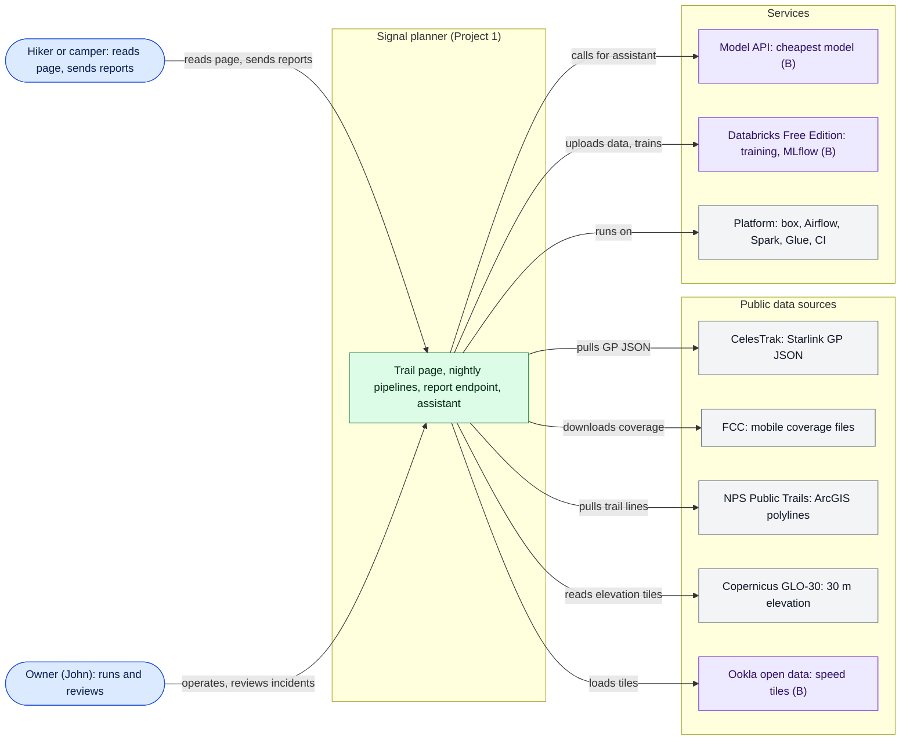
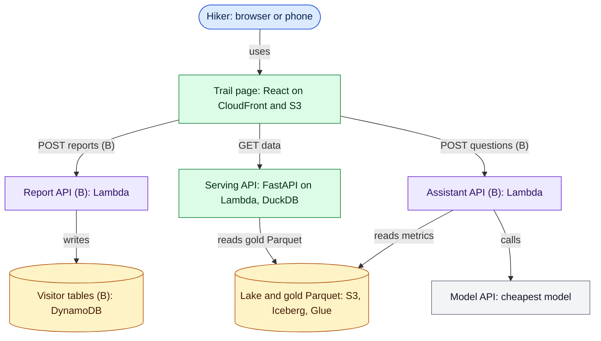
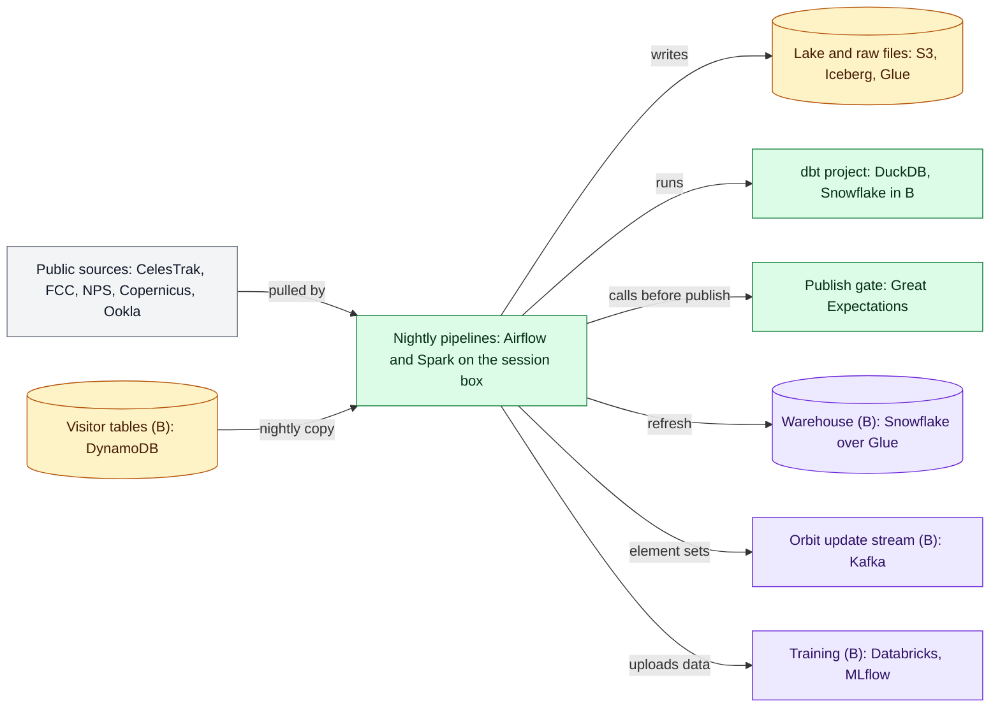
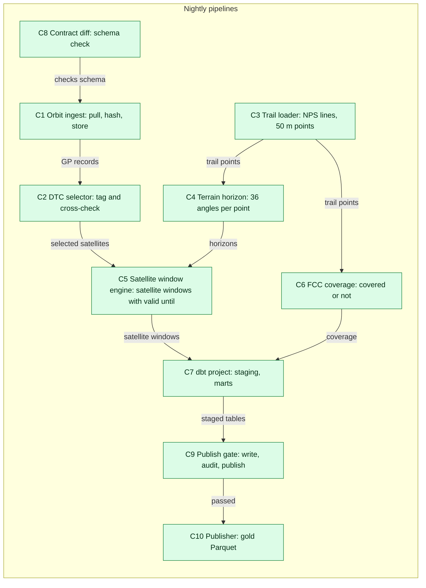
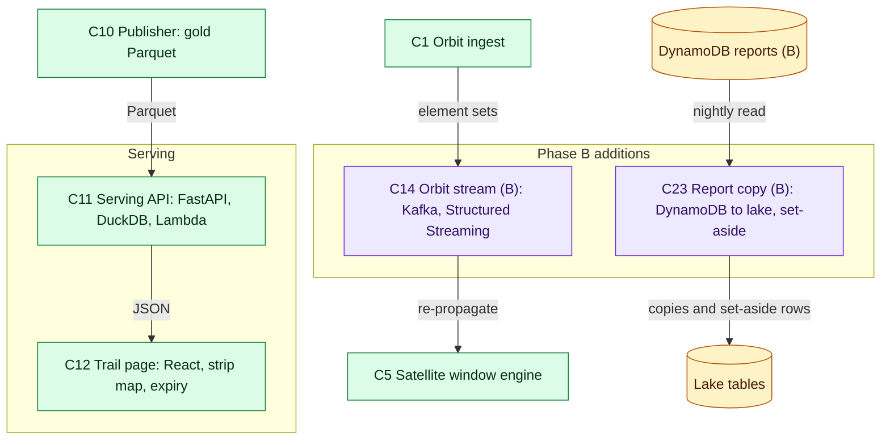
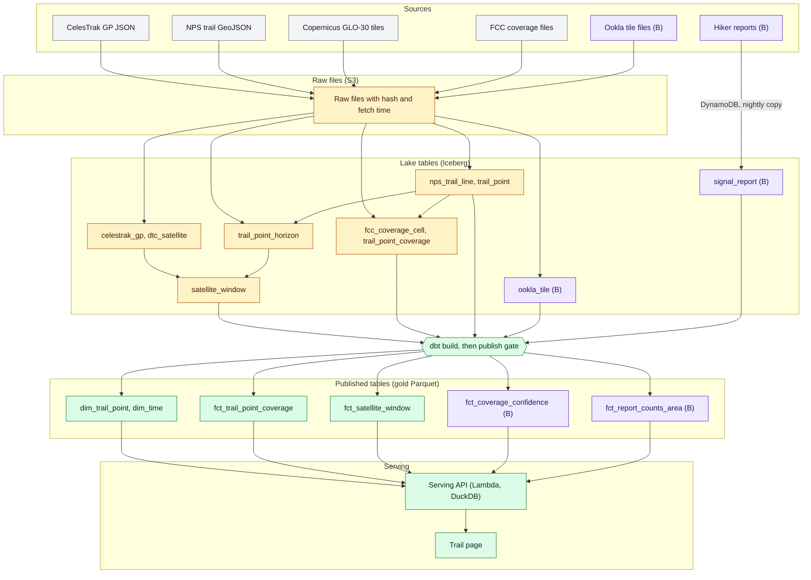
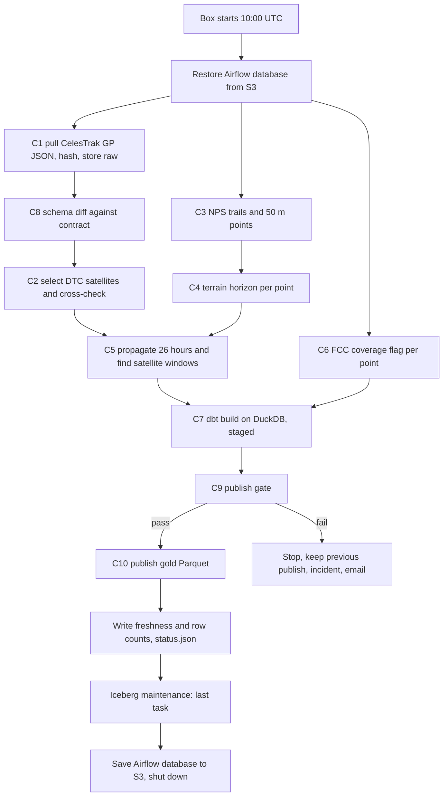
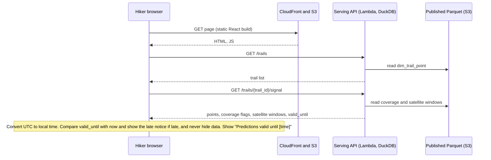
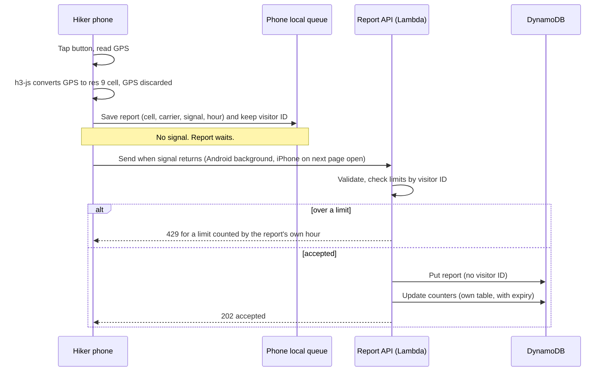
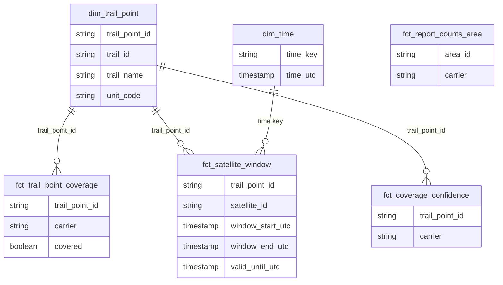

# Project 1 Design Doc: Will I have signal out there?

## 1. Status, owner, reviewers, last updated

| Field | Value |
|---|---|
| Status | Draft for review. Coding of this project does not begin until John approves this document, the requirements, the ADRs and the interface specs |
| Owner | John |
| Reviewers | John |
| Last updated | Oct 9, 2026 |
| Template | Documentation Plan "Design doc template" (Google design doc, arc42, C4 model) |
| Companion documents | [requirements.md](requirements.md), [adrs/](adrs/), [contracts/](contracts/), [openapi.yaml](openapi.yaml), [../Platform/platform-requirements.md](../platform/platform-requirements.md), [operations.md](operations.md), [security-and-privacy.md](security-and-privacy.md), [model-card.md](model-card.md), [README.md](README.md), [changelog.md](changelog.md) |
| Platform requirements | [../Platform/platform-requirements.md](../platform/platform-requirements.md): the platform parts this project depends on, specified in full. The separate platform document set is not written yet |

How to read the values in this document:

- A value is either a recorded decision or a confirmed fact. A decision is cited as "ADR 00NN" (architecture decision record, a short file in `adrs/`) or as "Decisions" followed by a row name from the Build Plan Decisions document. A fact comes from the build plan, the Build Plan Decisions document or the Documentation Plan.
- Everything else is an open question in section 16 (OQ-n, where OQ means open question), each with a GitHub issue placeholder.
- "Engineering standard N" means rule number N in the build plan's "Engineering standards" table. "Platform step 0.N" means step 0.N of the platform skeleton (the first build stage, before Project 1). "FR", "QR" and "AC" are functional requirement, quality requirement and acceptance criterion identifiers in requirements.md.
- Terms are explained in the glossary (section 17).
- Rules cited by number, with their content:
  - Engineering standard 1: keep raw files unchanged with source URL, fetch time and hash (for public archives that never change, keep a manifest of URL, size and hash instead of a copy).
  - Engineering standard 2: carry event time and a source key on every record.
  - Engineering standard 3: make tasks idempotent and atomic (overwrite a partition, never blind-append, use the run's data interval instead of the current time).
  - Engineering standard 4: write, audit, publish (new data lands in staging, passes checks, then goes live).
  - Engineering standard 5: every source has a contract, and the schema is diffed before loading.
  - Engineering standard 6: dbt layers are staging, intermediate and marts, with `source()` only in staging and unique and not_null tests on keys.
  - Engineering standard 8: keep business history in rows (SCD Type 2), not in Iceberg snapshots.
  - Engineering standard 9: pick the H3 resolution from the source and join with cell_to_parent.
  - Engineering standard 13: least privilege (read-only allowlisted tools for agents, write actions only with human approval, every key in Parameter Store, source text treated as data).
  - Engineering standard 14: measure and publish the numbers (input bytes, rows, runtime, cost per run, problems caught, eval scores, users).
  - Engineering standard 15: store every timestamp in UTC and convert only on the page.
  - Engineering standard 16: anything that runs around the clock (Lambda) writes only to always-on storage.
  - Platform step 0.1: repository and CI, including gitleaks and Trivy scans. Step 0.2: cloud base, with separate dev and live and one least-privilege role per pipeline. Step 0.4: serving template, including the cold-start notice. Step 0.5: status page, metrics table, failure email and incident records.
- Phases: Phase A is the first, smallest live version; Phase B adds depth (more sources, history, the warehouse, machine learning and the AI features); Phase C is the second-round scale phase and starts only after every project has reached Phase B. The platform skeleton is the first build stage, before Project 1: a tiny end-to-end version of the whole system.
- Three different things were called "satellite window" and now have separate names: "satellite window" (a period when a satellite is reachable), "prediction span" (the 26 hours the pipeline predicts) and "log retention period" (how long logs may be kept with internet addresses).
- "Valid until" in prose and `valid_until` in code mean the same thing: the time after which a run's predictions are no longer current.

- Names of components, functions, classes, tables, columns and endpoints other than those given in the Documentation Plan example (`compute_horizon`, `find_windows`) or in a source file (for example `TRLNAME`, `UNITCODE`, `[DTC]`) are proposals made by this document. John approves them with the document (OQ-21). They are marked "proposed" where they first appear in section 7.

---

## 2. Summary

Project 1 is a trip planner for hikers, campers and backpackers called "Will I have signal out there?". The visitor picks a trail and sees where each mobile carrier (phone provider) has coverage and where it drops out, when a Starlink Direct-to-Cell satellite text could get through once canyon walls and mountains that block the sky are accounted for, and how much to trust the coverage map at each point. Phase A puts a live page up for Grand Canyon National Park's Bright Angel, South Kaibab and North Kaibab trails with one carrier (T-Mobile) and the next 24 hours of satellite passes (26 hours are predicted so there is no daily gap). Phase B adds every carrier, measured speed tests, a warehouse, a coverage-confidence model, a trip-planning assistant, evals (automated tests of the assistant's answers) and hiker signal reports sent from the trail. Phase C (second round) extends to every national park, adds route upload and an offline trip pack, and compares a stronger model. The outcome is a public page that answers while the session box (the rented AWS server that runs the nightly pipelines) is switched off, never presents late data as current (old data stays visible with a late notice and the time of the last good run), and says "not enough measurements" instead of guessing where speed-test data is thin.

---

## 3. Context, scope and constraints

### 3.1 Background facts

| Fact | Source |
|---|---|
| CelesTrak's Starlink list carries a [DTC] tag in satellite names; John confirmed it | Decisions "Satellite selection"; build plan 1A first-run checks (confirmed) |
| Direct-to-Cell satellites fly at about 330 to 370 km with inclination 43 or 53 degrees; used as a cross-check | Build plan 1A.1 |
| Direct-to-Cell texting also needs T-Mobile service (in the United States) and a supported phone; T-Mobile is the Phase A carrier | Build plan, Project 1 description; ADR 0020 |
| FCC coverage files are downloaded per provider, state and technology as a Shapefile or GeoPackage; most datasets include H3 resolution 9 hexagons alongside the raw modeled coverage | Documentation Plan "Answered by research" |
| NPS Public Trails ArcGIS service: polylines, GeoJSON output supported, 2,000 records per request, trail name in `TRLNAME`, park in `UNITCODE` | Documentation Plan "Answered by research" |
| Copernicus GLO-30: 30 m, heights on the EGM2008 datum, a surface model that includes vegetation and buildings, water flattened | Documentation Plan "Answered by research" |
| Ookla open data: quarterly, about 600-meter tiles; license CC BY-NC-SA 4.0 | Build plan 1B.1; "Measured coverage (Project 1)" |
| H3 resolution 9 is the FCC coverage cell size, about 0.1 km2; a report cell is about 350 m across | Build plan 1B.8; Decisions "Report location" |
| H3 resolutions to use: 9 for FCC files and hiker reports, 8 for 15 arc-second rasters and Ookla tiles, 4 for 0.25 degree weather grids | Engineering standard 9 |

### 3.2 System boundary

Inside the boundary: the pipelines that ingest CelesTrak, NPS, Copernicus, FCC (Phase A) and Ookla (Phase B) data; the terrain and satellite window computations; the dbt models; the publish gate; the serving Lambda; the trail page; and in Phase B the report endpoint, the assistant, the model and the warehouse marts.

Outside the boundary, owned by the platform (the shared system that all five projects run on) and linked rather than repeated: the session box, k3s (a small Kubernetes), Airflow, Spark, Terraform, CI, Parameter Store, the metrics table and status page, S3 buckets and Glue catalog, the serving template, and the nightly schedule. See [../Platform/platform-requirements.md](../platform/platform-requirements.md).

### 3.3 Budget and hard limits

| Item | Limit | Source |
|---|---|---|
| Whole platform | Under $50 a month, working from a browser only; a normal month costs about $23 to $46 on spot pricing (cheaper interruptible servers); skeleton and Phase A months usually cost under $20 | Decisions "Budget"; operating model |
| Session box | 4-hour session limit; idle shutdown; nightly run hard maximum 2 hours | Decisions "Cost guards", "Nightly shutdown" |
| Backup guard | $40 AWS budget with an action | Decisions "Cost guards" |
| Spark jobs (Spark is the batch data-processing engine) | Each job has a maximum number of rows read and written and a maximum runtime. A job over either limit stops before publishing and opens an incident. The values are open (OQ-15) | Build plan "Hard limits" |
| Satellite windows | Stored as start and end times, never one row per minute; a size estimate goes in this design document before build step 1A.3 and the row limit is set from it (OQ-1) | Build plan "Hard limits" |
| Snowflake | Resource monitor at 3 credits a month (about $6); a time limit on every query | Decisions "Snowflake" |
| AI model | $10 a month spend limit set in the API account before the first call; a daily question cap; a token limit per answer; cheapest model only (20 questions a day and token limits, ADR 0038; OQ-17) | Decisions "AI spending"; build plan |
| DynamoDB | Provisioned within the free tier; heavy traffic is throttled, not billed | Build plan "Hard limits" |
| S3 | Clean-up rules (step 1B.9) plus an alarm if storage passes a set size (size open, OQ-15) | Build plan "Hard limits" |

### 3.4 Licenses and attribution

| Source | Terms | Page and README obligation |
|---|---|---|
| Ookla open data | CC BY-NC-SA 4.0; non-commercial; derived data shared under the same license | Exact notice on the page and in the README (ADR 0013) |
| Copernicus elevation | Free under the Copernicus licence, with credit | Credit on the page |
| NPS trail files | Public, from data.gov | Credit on the page |
| TIGER/Line roads (U.S. Census Bureau) | Declared CC0 (public domain) on data.gov; some files carry a rights flag, "otherRestrictions". Checked on the Census page before the first load (ADR 0035) | Derived distances only; credit on the page |
| CelesTrak, FCC | Credit wording and licence status in ADR 0037 (OQ-22) | Credit on the page ("with credits", build plan 1A.6) |
| Databricks Free Edition | Non-commercial | Licensing checked before charging for any project |
| OpenCelliD | Share-alike; used for tower locations (Decided by John, Oct 9, 2026, ADR 0024); derived data carries the same license | Recorded in the license register and on the page; credit wording in ADR 0037 (OQ-22; OpenCelliD terms to verify) |

Licensing must be checked before charging for any of the projects (build plan "Assumptions").

### 3.5 Privacy rules

- Exact coordinates never leave the phone; the phone converts GPS to an H3 resolution 9 cell and discards the coordinates (ADR 0009).
- Visitor identity is a random ID created on the phone; no internet addresses are used (ADR 0011).
- Limit counters are stored apart from reports and expire; reports carry no ID that links them (ADR 0011). Limits: 10 reports a day per visitor, one per cell per visitor every 24 hours, 50 a day for the whole system, applied by the hour the report was made on the phone.
- Internet addresses in CloudFront and API Gateway logs are removed before anything is stored beyond a short log retention period (ADR 0023).
- Point-in-time recovery is off for the hiker reports table, so deletion is final at 30 days (ADR 0022).
- Raw report rows delete themselves 30 days after the nightly copy into the lake and Snowflake (ADR 0012).
- Email addresses are not collected by this project.
- Timestamps are stored in UTC (engineering standard 15).

---

## 4. Goals and non-goals

### 4.1 Goals

1. Phase A: a public trail page for Bright Angel, South Kaibab and North Kaibab showing, for one carrier (T-Mobile, ADR 0020), covered or not along the trail, and the next 24 hours of satellite windows (26 hours predicted, ADR 0019) with terrain accounted for (ADR 0001, 0003, 0004).
2. Never present late data as current: show old data with a visible late notice and the time of the last good run (ADR 0006, amended).
3. Show how much to trust the coverage map, and say "not enough measurements" where there are too few speed tests (ADR 0008).
4. Phase B: every carrier, measured speeds, a warehouse, a trip-planning assistant with cited plans, evals in CI, and hiker reports that stay private (ADR 0009 to 0012, 0017).
5. Keep every paid item under a hard limit (section 3.3).

### 4.2 Non-goals

| Non-goal | Basis |
|---|---|
| Other parks, other carriers and speed tests in Phase A | ADR 0001; those arrive in Phase B and C |
| Guessing coverage in dead zones | Speed tests miss dead zones; the model must not guess there (ADR 0008) |
| Receiving exact coordinates from any visitor | ADR 0009 |
| Identifying visitors by internet address, account or email | ADR 0011 |
| Live model calls that depend on Databricks being up | The site never depends on Databricks (ADR 0014) |
| Staged production failures | Decisions "Failure testing" |
| Always-on servers | Everything on AWS at about $0 idle; public pages are static files plus Lambda |
| Commercial use | Non-commercial licenses (section 3.4) |
| Phase C features in the first two phases | Phase C starts only after every project has reached Phase B. Phase C done-when checks are a recorded gap, written when Phase C is designed (Decided by John, Oct 9, 2026) |

---

## 5. Requirements

The full set is in [requirements.md](requirements.md). Summary:

**Functional (76 requirements, FR-1 to FR-76; numbers are never reused and a few are out of order, see the note in requirements.md section 4)**

- Phase A (FR-1 to FR-24, FR-75, FR-76): orbit ingest and Direct-to-Cell selection; trail sampling at 50 m; terrain horizon to about 15 km; SGP4 at 1-minute steps for 26 hours; reachability above 10 degrees and the terrain horizon; satellite windows as start and end times with a valid until stamp; FCC coverage flag per trail point for one carrier; dbt on DuckDB; contracts; Great Expectations publish gate; gold Parquet; React trail page with the late notice and credits.
- Phase B (FR-25 to FR-62, FR-66 to FR-74): every carrier; Ookla tiles with license notice; orbit update stream; Snowflake marts with SCD Type 2; MetricFlow, Superset, Marquez; confidence model with a repo copy; AI foundations; trip-planning assistant; evals in CI; hiker reports with offline queue and limits; operations hardening.
- Phase C (FR-63 to FR-65): national scope and route upload, offline trip pack, model comparison.

**Quality (QR-1 to QR-22; "quality" means speed, freshness, cost limits, privacy and availability)**

Freshness (daily 10:00 UTC run, hard maximum 2 hours); late data never shown as current; publish gate; availability with the box off; cold-start notice and measurement; cost under $50 with hard limits; privacy of reports and retention; licensing credit; security; rerun safety; observability; honest confidence; honest AI answers; contract integrity; UTC handling. Each has a verification method in requirements.md section 5.

**Acceptance criteria**

Every feature's build plan "Done when" check is reproduced as AC-1A.1 to AC-1A.6 and AC-1B.1 to AC-1B.9 in requirements.md section 6.

---

## 6. Architecture

### 6.1 C4 level 1: system context

### 6.2 C4 level 2: containers

Phase A containers are unmarked; Phase B containers are marked (B). The view is split in two: what a visitor touches, and what runs each night.

**Visitor-facing containers**

**Nightly containers**

### 6.3 C4 level 3: components of the nightly pipelines container

Component identifiers C1 to C24 are defined in section 7. The diagram is split in two: first the pipeline components, then the serving components and the Phase B additions.

**Pipeline components (Phase A)**

**Serving components and Phase B additions**

### 6.4 Architecture decisions that shape the diagrams

- Everything the public page needs is published as Parquet, so the page works with the box off (ADR 0006, amended: late data stays visible with a late notice; platform serving template).
- The nightly run writes; Lambda reads (and in Phase B writes only to DynamoDB), following engineering standard 16.
- Dev and live are separate copies built from the same code and containers (platform).

### 6.5 Data flow

The path every dataset takes, from source to the page. Phase B additions are purple.

---

## 7. Component breakdown

Naming status: component identifiers, function names, class names, table names and column names in this section are proposals of this document, except `compute_horizon(point, elevation_tiles)` and `find_windows(positions, horizon, min_elev)`, which come from the Documentation Plan, and source names such as `TRLNAME` and `UNITCODE` (OQ-21).

Every component runs on the platform listed in section 11. Re-run safety rules (engineering standard 3) apply to every component that writes data: it overwrites a partition (one slice of a table, here one run date), uses the run's data interval (the date the run is responsible for) instead of the current time, and never appends blindly.

### 7.1 Phase A components

#### C1 Orbit ingest (F-1A.1)

| Item | Detail |
|---|---|
| Job | Pull CelesTrak GP data (orbital elements) as JSON, keep the raw file unchanged with its hash and load time, and pass the records to the selector (C2) |
| Inputs | CelesTrak Starlink list (GP, JSON). Exact URL and field list: OQ-20 |
| Outputs | Raw file in the raw bucket with URL, fetch time and hash; Iceberg table `celestrak_gp` (partition per pull); a metrics-table row (freshness, row count) |
| Main functions and classes (proposed) | `fetch_gp_json(url, last_fetch_time)`: calls CelesTrak at most once per 2-hour update and stops on any response other than HTTP 200; `store_raw(payload, url, fetched_at)`: writes the file and manifest with hash; `load_gp_partition(spark, raw_path, logical_date)`: overwrites the partition; Airflow DAG `orbit_ingest` |
| Contract | contracts/celestrak_gp.yaml |
| ADRs | 0002, 0018 |

#### C2 Direct-to-Cell selector (F-1A.1)

| Item | Detail |
|---|---|
| Job | Select Direct-to-Cell satellites by the [DTC] tag in their names; cross-check altitude (about 330 to 370 km) and inclination (43 or 53 degrees); log any disagreement |
| Inputs | Records of `celestrak_gp` for the run |
| Outputs | Selected satellites (Iceberg `dtc_satellite`), disagreement list (logged and listed in the table `dtc_disagreement`) |
| Main functions and classes (proposed) | `select_dtc_satellites(gp_records)` returns selected and disagreements; `has_dtc_tag(name)`; `altitude_km_from_elements(record)` (derived from mean motion and eccentricity); `check_orbit(record)` returns the list of disagreements for one record; class `OrbitCheckResult` |
| Contract | None. These are internal tables (neither a source nor a published table); their schema is defined in code and tests |
| ADRs | 0002 |

#### C3 Trail loader and sampler (F-1A.2)

| Item | Detail |
|---|---|
| Job | Load NPS trail lines for Grand Canyon and sample a point every 50 meters |
| Inputs | NPS Public Trails ArcGIS service (polylines; GeoJSON output; 2,000 records per request; `TRLNAME`, `UNITCODE`). Park filter: Grand Canyon by `UNITCODE` (the code value is not recorded, OQ-20) |
| Outputs | Raw GeoJSON pages with hash; Iceberg `nps_trail_line`; Iceberg `trail_point` (50 m spacing) |
| Main functions and classes (proposed) | `fetch_trail_pages(service_url, unit_code)`: pages of up to 2,000 records; `parse_trail_geojson(payload)`; `sample_points_along_line(line, spacing_m)`; `build_trail_points(spark, trails_df, spacing_m)`; class `TrailPoint` |
| Contract | contracts/nps_trails.yaml |
| ADRs | 0004 |

#### C4 Terrain horizon engine (F-1A.2)

| Item | Detail |
|---|---|
| Job | For every trail point, compute how high terrain rises in each compass direction out to about 15 km; Spark computes many points at the same time |
| Inputs | `trail_point`; Copernicus GLO-30 tiles (30 m, EGM2008 datum, surface model) covering the park plus the 15 km margin |
| Outputs | Iceberg `trail_point_horizon` (36 horizon angles per point) |
| Main functions and classes | See table 7.A (full list) |
| Contract | contracts/copernicus_glo30.yaml (source); contracts/trail_point_horizon.yaml (output) |
| ADRs | 0004 |

#### C5 Satellite window engine (F-1A.3)

| Item | Detail |
|---|---|
| Job | Propagate selected satellites with SGP4 at 1-minute steps for 26 hours (ADR 0019; the page says the next 24 hours); find when each satellite is above 10 degrees and above the terrain horizon; write satellite windows with a valid until stamp; record how satellite windows change at 5 and 20 degrees |
| Inputs | `dtc_satellite`, `trail_point`, `trail_point_horizon`, run logical date |
| Outputs | Iceberg `satellite_window` (one row per point, satellite and satellite window; partition per run date); sensitivity figures for 5, 10 and 20 degrees |
| Main functions and classes | See table 7.B (full list) |
| Contract | contracts/fct_satellite_window.yaml (mart); internal Iceberg table follows the same columns |
| ADRs | 0003, 0005, 0006, 0019 |

#### C6 FCC coverage loader (F-1A.4)

| Item | Detail |
|---|---|
| Job | Load FCC mobile coverage (H3 resolution 9 files) for one carrier (T-Mobile, ADR 0020) in Arizona; mark each trail point covered or not |
| Inputs | FCC coverage file for one provider, Arizona, per technology (Shapefile or GeoPackage; includes H3 resolution 9 hexagons). The T-Mobile provider name and technology as named in the file: OQ-20 (Phase B carrier list: OQ-11) |
| Outputs | Raw file with hash; Iceberg `fcc_coverage_cell` (H3 resolution 9 cell, carrier, technology, release); Iceberg `trail_point_coverage` (point, carrier, covered flag) |
| Main functions and classes (proposed) | `download_fcc_file(provider, state, technology)`; `read_fcc_h3_cells(path)`; `point_to_cell(lat, lon, res=9)` using H3; `flag_points_covered(points_df, coverage_df, carrier)` |
| Contract | contracts/fcc_mobile_coverage.yaml |
| ADRs | 0007 |

#### C7 dbt project (F-1A.5)

| Item | Detail |
|---|---|
| Job | Build staging, intermediate and a small star schema (a central fact table joined to descriptive tables; here trail point, time, coverage and satellite windows) on DuckDB; `source()` only in staging; unique and not_null tests on keys |
| Inputs | Iceberg tables from C1 to C6 (how dbt on DuckDB reads Iceberg is a platform matter, OQ-40) |
| Outputs | Marts `dim_trail_point`, `dim_time`, `fct_trail_point_coverage`, `fct_satellite_window` |
| Models (proposed) | Staging: `stg_celestrak_gp`, `stg_nps_trail`, `stg_trail_point_horizon`, `stg_fcc_coverage`, `stg_satellite_window`. Intermediate: `int_trail_point_coverage`, `int_trail_point_windows`. Marts as above |
| Contracts | contracts/*.yaml |
| ADRs | 0018 |

#### C8 Contract and schema diff (F-1A.5)

| Item | Detail |
|---|---|
| Job | Diff each source's schema against its contract before loading so an upstream change fails loudly and early |
| Inputs | Contract YAML (ODCS) and a sample or actual source file |
| Outputs | Pass, or a failure naming the changed field; written to the run log and the metrics table |
| Main functions and classes (proposed) | `load_contract(path)`; `diff_schema(contract, observed_schema)` returns added, removed and changed fields; `assert_no_breaking_change(diff)` |
| ADRs | 0018 |

#### C9 Publish gate (F-1A.5)

| Item | Detail |
|---|---|
| Job | Write, audit, publish: new data lands in staging, passes Great Expectations checks (freshness, empty results, value ranges), then goes live; publishing stops when a check fails |
| Inputs | Staged mart tables |
| Outputs | Pass or fail result; on pass, promotion to the publish location |
| Main functions and classes (proposed) | `run_publish_gate(staged_tables, suite)`; expectation suites `suite_satellite_window`, `suite_trail_point_coverage`, `suite_trail_point`; `promote_to_published(staged_path, published_path)` |
| Value-range limits | Two checks need no recorded number: a satellite window never starts after it ends, and elevation angles are between 0 and 90 degrees. Freshness thresholds and all other value ranges are open (OQ-15) |
| ADRs | 0006, 0018 |

#### C10 Publisher (F-1A.6)

| Item | Detail |
|---|---|
| Job | Write gold tables as Parquet to the published location read by the serving Lambda |
| Inputs | Mart tables that passed the gate |
| Outputs | Parquet files for `dim_trail_point`, `dim_time`, `fct_trail_point_coverage`, `fct_satellite_window` |
| Main functions and classes (proposed) | `publish_gold_parquet(tables, destination, logical_date)` |
| ADRs | 0006 |

#### C11 Serving API (F-1A.6)

| Item | Detail |
|---|---|
| Job | Answer page requests from published Parquet using DuckDB inside a FastAPI Lambda behind API Gateway; works with the box off |
| Inputs | HTTP requests (section 10); published Parquet |
| Outputs | JSON responses |
| Main functions and classes (proposed) | FastAPI app `app`; `list_trails()`; `get_trail_signal(trail_id)`; `query_gold(sql, params)` (read-only DuckDB connection); response models `TrailSummary`, `TrailSignal`, `PointSignal`, `WindowOut`, `ErrorOut` |
| Contract | openapi.yaml |
| ADRs | 0006 |

#### C12 Trail page (F-1A.6)

| Item | Detail |
|---|---|
| Job | Let the visitor pick a trail and show a strip map (a line along the trail with bars where the carrier has coverage and no bars where it does not) and the next satellite windows; show "Predictions valid until [time]" in local time; when the data is late or the run failed, keep showing the old data with a visible late notice that includes the time of the last good run (ADR 0006, amended); show credits, the T-Mobile and supported-phone statement and the cold-start notice |
| Inputs | Serving API responses |
| Outputs | The page in the browser |
| Main functions and classes (proposed) | React components `TrailPicker`, `StripMap`, `WindowList`, `ValidUntilBanner`, `Credits`, `ColdStartNotice`, `DtcRequirementsNote`; `LateNotice` (the visible late notice); functions `isRunLate(validUntilUtc, now)` (definition of late: OQ-23), `formatLocalTime(utcIso)`, `windowsWithLateFlag(windows, now)` (marks each satellite window as late or current and never hides data); a timer that re-evaluates lateness while the page stays open |
| ADRs | 0006 |

### 7.2 Phase B components

#### C13 Ookla and all-carrier loader (F-1B.1)

| Item | Detail |
|---|---|
| Job | Add every carrier's FCC coverage for the park; load Ookla's open mobile speed-test data for Arizona (GPS-accurate tests only); load OpenCelliD tower locations (ADR 0024); put the license notices on the page and in the README |
| Inputs | FCC files (all providers), Ookla quarterly tiles (about 600 m; a manifest of URL, size and hash instead of a full copy, per standard 1) |
| Outputs | Iceberg `fcc_coverage_cell` (all carriers), Iceberg `ookla_tile` (H3 resolution 8, per engineering standard 9) |
| Main functions and classes (proposed) | `load_ookla_arizona(spark, quarter)`; `filter_gps_accurate(df)`; `tile_to_h3_res8(tile)`; `load_all_carriers(spark, park)`; `load_opencellid_towers(spark)` |
| Contract | contracts/ookla_open_data.yaml, fcc_mobile_coverage.yaml |
| ADRs | 0007, 0013 |

#### C14 Orbit update stream (F-1B.2)

| Item | Detail |
|---|---|
| Job | Publish each new element set to Kafka; a Structured Streaming job (availableNow trigger) finds changed satellites and triggers re-propagation. This document states plainly that the stream is low-rate (few messages) |
| Inputs | New `celestrak_gp` records from C1 |
| Outputs | Kafka topic of element sets; Iceberg table of changed satellites; trigger for C5 |
| Main functions and classes (proposed) | `publish_element_sets(records, topic)`; `build_orbit_stream(spark, schema)` with an explicit schema, S3 checkpoints, a watermark and `dropDuplicatesWithinWatermark`; `detect_changed_satellites(df)`; `trigger_repropagation(satellite_ids)` |
| Parameters | Watermark value, topic name, definition of "changed": OQ-30 |
| Contract | contracts/orbit_update_stream.yaml |
| ADRs | 0016 |

#### C15 Warehouse sync (F-1B.3)

| Item | Detail |
|---|---|
| Job | Connect Snowflake to the Glue catalog; refresh after each pipeline run; run dbt marts on Snowflake with SCD Type 2 carrier coverage rows; MetricFlow metrics; Superset dashboard with nightly snapshot charts; 3-credit resource monitor |
| Inputs | Iceberg tables via Glue; FCC release history |
| Outputs | Snowflake marts; `dim_carrier_coverage_history` (SCD Type 2); metric definitions; snapshot chart files published to the site |
| Main functions and classes (proposed) | `refresh_snowflake_iceberg_tables(tables)`; dbt snapshots/models `dim_carrier_coverage_history`; MetricFlow files under `metrics/`; `publish_snapshot_charts(dashboard_id, destination)` |
| Open | Whether the connection works and the refresh shows new data: OQ-4 |
| ADRs | 0015 |

#### C16 Lineage (F-1B.3)

| Item | Detail |
|---|---|
| Job | OpenLineage events from Airflow and Spark to Marquez (ARM build of one pinned version, made once in GitHub Actions); dbt docs catalog page |
| Open | Whether the ARM build (for the ARM processors of the session box) succeeds: OQ-5. The platform owns this question; if the build fails, the lineage tool choice is revisited |
| Platform link | [../Platform/platform-requirements.md](../platform/platform-requirements.md), section 6 (lineage) |

#### C17 Coverage confidence model (F-1B.4)

| Item | Detail |
|---|---|
| Job | Predict how likely the FCC map is to be right where speed tests exist; give a confidence level only where enough speed tests exist nearby; elsewhere output the "not enough measurements" notice. Train in Databricks, track in MLflow, export the results and model into the GitHub repository (repo), and score in the nightly run with the repo copy |
| Inputs | FCC coverage claims, Ookla tiles, terrain features, distance to nearest tower (OpenCelliD, ADR 0024), remoteness (distance in metres from each trail point to the nearest TIGER/Line road or NPS trail line; source decided in ADR 0035), report labels (from C23) |
| Outputs | Published `fct_coverage_confidence`; MLflow runs; repo files with results and the chosen model |
| Main functions and classes (proposed) | `build_training_frame(spark)`; `upload_to_databricks(frame_path)` (Files API); `train_and_log(frame)` (MLflow); `export_run_to_repo(run_id)` (a manual procedure: download results and model, commit to GitHub; automation is an open test, OQ-19); `score_cells(model_path, frame)`; `has_enough_tests(cell, tests_df, min_tests, radius)` (thresholds OQ-14); `keep_alive_ping()` (monthly job) |
| Model family and features | scikit-learn (a Python machine-learning library) is the planned library, from the build plan's technology table; the model type is logistic regression (ADR 0031; the remoteness source is still open, OQ-18) |
| ADRs | 0008, 0014 |

#### C18 AI foundations (F-1B.5)

| Item | Detail |
|---|---|
| Job | Log every model call to S3 and load it into `llm_calls`; trace every agent run to X-Ray; expose metrics as MCP tools with a read-only allowlisted SQL fallback logged separately; version prompts in git; enforce structured output; an eval harness (the program that runs the answer tests); a daily question cap; the $10 monthly spend limit |
| Main functions and classes (proposed) | `log_llm_call(model, prompt_version, tokens, latency, cost)`; `load_llm_calls(spark, date)`; MCP server `metrics_mcp` with example tools `get_signal_summary` and `get_windows` (the real tool list and names are open, OQ-21); `run_readonly_sql(sql)` (allowlist, separate log); `check_daily_cap(day)`; `with_trace(name)` |
| Contract | ../Platform/contracts/llm_calls.yaml (platform table; Project 1 adds no columns) |
| ADRs | 0017 |

#### C19 Trip-planning assistant (F-1B.6)

| Item | Detail |
|---|---|
| Job | Take a plain-language question and return a check-in plan: where each carrier works, when satellite windows open, how confident the map is, citing the trail points and times used; say so when the data cannot answer |
| Main functions and classes (proposed) | `answer_trip_question(question)`; `plan_from_tool_results(results)`; `cite(points, times)`; `refuse_unanswerable(reason)`; structured output model `CheckInPlan` |
| Decided | The assistant answers only within the prediction span and says so for later days (ADR 0021) |
| ADRs | 0017 |

#### C20 Evals in CI (F-1B.7)

| Item | Detail |
|---|---|
| Job | 30 or more questions with known answers, graded exactly on tool choice, numbers and refusal; an LLM judge (a second model that scores answers) for clarity, calibrated on 50 answers graded by hand; red-team set of 20 or more prompts; votes in DynamoDB; A/B test of two prompt versions |
| Main functions and classes (proposed) | `run_eval_suite(cases)`; `grade_exact(case, result)`; `judge_clarity(answer)`; `calibrate_judge(hand_grades)`; `run_red_team(prompts)`; `record_vote(vote)`; `assign_prompt_variant(visitor_id)` |
| Thresholds | Not recorded: OQ-16 |
| ADRs | 0017 |

#### C21 Report client on the phone (F-1B.8)

| Item | Detail |
|---|---|
| Job | Two buttons; read GPS; convert to an H3 resolution 9 cell with h3-js (the H3 JavaScript library); discard coordinates; build the report; queue it on the phone; send when signal returns; show "1 report waiting to send" on iPhone |
| Main functions and classes (proposed) | React component `ReportButtons`; `captureCell()` (GPS to cell, then drops coordinates); `buildReport(cell, carrier, signal, now)` (time rounded to the hour, UTC); `enqueueReport(report)` (persistent local store); `flushQueue()`; background send on Android; `PendingReportsNote`; `getOrCreateVisitorId()` (random ID, stored on the phone only) |
| Answered | Visitor ID format and transport: ADR 0025 (OQ-38). Report time zone: UTC per standard 15 |
| ADRs | 0009, 0010, 0011 |

#### C22 Report API and limiter (F-1B.8)

| Item | Detail |
|---|---|
| Job | Validate a report; apply the limits by the hour the report was made on the phone (not arrival time): 10 reports a day per visitor, one per cell per visitor every 24 hours, and at most 50 a day for the whole system (ADR 0011, amended); write the report to DynamoDB without any ID; store counters apart from reports with expiry (lifetime: OQ-26); a system-wide daily counter holds no visitor ID |
| Main functions and classes (proposed) | Lambda handler `post_report`; `validate_report(body)`; `check_and_increment_limits(visitor_id, cell, now)`; `write_report(report)`; DynamoDB tables `signal_reports`, `report_limit_counters`; models `ReportIn`, `ReportAccepted`, `LimitExceeded` |
| Answered | Day boundary, accepted report hours and counter lifetime: ADR 0026 (OQ-26). Log retention: 7 days, ADR 0029 (OQ-29). Counters recovery: off, ADR 0025 (OQ-41) |
| Contract | contracts/hiker_signal_reports.yaml; openapi.yaml |
| ADRs | 0011, 0012 |

#### C23 Nightly report copy and set-aside (F-1B.8)

| Item | Detail |
|---|---|
| Job | Copy the day's raw reports into the lake and Snowflake; set each copied row to expire 30 days after the copy; set aside impossible patterns for review; produce label candidates (reports that may train the model) and per-area counts |
| Main functions and classes (proposed) | `copy_reports_to_lake(spark, logical_date)`; `set_expiry_after_copy(report_keys)` (sets the DynamoDB expiry attribute to 30 days after the copy); `find_impossible_reports(reports_df, mapped_area_df)`; `find_contradicting_bursts(reports_df)`; `build_label_candidates(reports_df, n_per_cell_day)` (a cell qualifies at N reports in one day; N: OQ-12); `build_report_counts_area(reports_df)` |
| Outputs | Iceberg `signal_report`, `signal_report_set_aside`; published `fct_report_counts_area` |
| Open | OQ-12, OQ-13. Area and minimum count answered in ADR 0030 (OQ-35) |
| ADRs | 0012, 0008 |

#### C24 Operations hardening (F-1B.9)

| Item | Detail |
|---|---|
| Job | S3 lifecycle rules (automatic deletion by age); storage-size alarm; cold-start measurement; weekly smoke test of every source; one de-duplicated GitHub issue per failure, closed on recovery |
| Main functions and classes (proposed) | Terraform lifecycle rules (platform module); `measure_cold_starts(endpoint, n)`; `smoke_pull(source)` per source; `open_or_update_issue(incident_key)`; `close_issue_on_recovery(incident_key)` |
| ADRs | 0018 |

### 7.A Terrain horizon (1A.2): every function and class

Convention proposed here: 36 horizon angles, one per 10-degree compass sector (36 sectors is the figure in the Documentation Plan's example; the 10-degree width follows from 360 divided by 36). Sector 0 is centered on north and sectors run clockwise (proposed convention; OQ-24).

| Function or class | Purpose | Takes | Returns |
|---|---|---|---|
| `TrailPoint` (class) | One sampled point on a trail | `point_id`, `trail_id`, `seq`, `lon`, `lat`, `elevation_m` | Immutable record |
| `ElevationTiles` (class) | The loaded set of GLO-30 tiles for the park plus margin, with fast lookup | Tile keys or a bounding box | Object with `elevation_at(lon, lat)` and `profile(lon, lat, azimuth_deg, max_range_m, step_m)` |
| `HorizonProfile` (class) | The 36 angles for one point | `point_id`, `angles_deg` (36 values) | Immutable record |
| `sample_points_along_line(line, spacing_m)` | Place a point every `spacing_m` (50) along a trail polyline | A line geometry, spacing in meters | Ordered list of `(lon, lat)` |
| `build_trail_points(spark, trails_df, spacing_m)` | Spark wrapper that numbers points per trail and adds elevation | Spark DataFrame of trail lines, spacing | DataFrame of `TrailPoint` rows |
| `load_elevation_tiles(bbox)` | Find and open the GLO-30 tiles covering the bounding box plus the horizon range | Bounding box in lon/lat | `ElevationTiles` |
| `compute_horizon(point, elevation_tiles)` | How high terrain rises in each compass direction around a trail point | A trail point, elevation tiles | 36 horizon angles |
| `ray_elevation_profile(point, azimuth_deg, elevation_tiles, max_range_m)` | Terrain heights along one compass direction out to about 15 km | Point, azimuth, tiles, range | Arrays of distance and height |
| `max_elevation_angle(observer_height_m, distances_m, heights_m)` | The highest angle above the horizontal along one profile (what blocks the sky in that direction) | Observer height, profile arrays | One angle in degrees |
| `compute_horizons(spark, trail_points_df, tiles_index)` | Run `compute_horizon` for every point in parallel in Spark | Points DataFrame, tile index | DataFrame of `HorizonProfile` rows |
| `horizon_at(horizon, azimuth_deg)` | Horizon angle for any azimuth, used by the satellite window engine | A `HorizonProfile`, an azimuth | One angle in degrees (selection of sector or interpolation: OQ-24) |
| `validate_horizon(horizon)` | Value-range check used by tests and the publish gate | A `HorizonProfile` | Pass or a list of violations |

Decided in ADR 0036 (OQ-24): range 15 km; ray step 30 m; observer height 1.7 m; Earth curvature applied; atmospheric refraction not applied (conservative); surface model kept; 36 sectors, final; `horizon_at` interpolates linearly; the AC-1A.2 margin is 5 degrees between the medians of the canyon and rim fixtures.

### 7.B Satellite windows (1A.3): every function and class

| Function or class | Purpose | Takes | Returns |
|---|---|---|---|
| `SatelliteElements` (class) | One selected satellite's orbital elements from a GP record | GP record fields | Immutable record with NORAD id, name, epoch, elements |
| `SatellitePosition` (class) | A satellite's position at one minute | Satellite id, time (UTC), position in an earth-fixed frame | Immutable record |
| `Window` (class) | One reachable interval for one point and satellite | `point_id`, `satellite_id`, `start_utc`, `end_utc` | Immutable record |
| `WindowRun` (class) | One run's metadata | Run id, logical date, span start, span length, `min_elev_deg`, `valid_until_utc` | Immutable record |
| `propagate_satellites(elements, start, minutes, step_minutes)` | Position of each selected satellite at 1-minute steps for 26 hours using SGP4 | Elements list, start time, 1,560 minutes (26 hours), 1-minute step | `SatellitePosition` list per satellite |
| `look_angles(position, point)` | Azimuth and elevation of a satellite seen from a trail point | A `SatellitePosition`, a `TrailPoint` | `(azimuth_deg, elevation_deg)` |
| `find_windows(positions, horizon, min_elev)` | When a satellite clears both the minimum elevation and the terrain | Satellite positions, a horizon profile, the minimum elevation | Windows as start and end times |
| `reachable_flags(positions, horizon, min_elev)` | One true or false value per minute: above `min_elev` and above `horizon_at(horizon, azimuth)` | Same as `find_windows` | Boolean list aligned to the minutes |
| `flags_to_windows(flags, times)` | Collapse consecutive true minutes into start and end times, so no row per minute is ever stored | Flags, times | List of `(start_utc, end_utc)` |
| `compute_valid_until(span_start, span_minutes)` | The time the run's predictions stop being valid | Span start, span length | A UTC time: the end of the prediction span (ADR 0019); the late test built on it is OQ-23 |
| `run_window_job(spark, run, satellites_df, points_df, horizons_df)` | Spark job: propagate once per satellite, evaluate against every trail point in parallel, build satellite windows | Run metadata and the three DataFrames | DataFrame of `Window` rows plus the `WindowRun` |
| `enforce_row_limit(df, max_rows)` | Stop before publishing if the job would write more rows than its limit | DataFrame, limit | The same DataFrame, or raises and opens an incident (limit value: OQ-1, OQ-15) |
| `write_window_partition(df, logical_date)` | Overwrite only the run date's partition so a rerun replaces only that day | DataFrame, logical date | Iceberg commit |
| `sensitivity_report(positions, horizons, elevations)` | Count and total length of satellite windows at 5, 10 and 20 degrees for the design note | Positions, horizons, `[5, 10, 20]` | A summary table |

Edge convention proposed for `flags_to_windows`: a satellite window starts at the first minute whose flag is true and ends at the last minute whose flag is true. Because the steps are 1 minute apart, satellite window edges are accurate to 1 minute. This convention is a proposal that John approves with the document (OQ-21).

Partition rule: the partition key is the run's logical date in UTC (engineering standard 3: use the run's data interval, not the current time).

---

## 8. Runtime view

### 8.1 Nightly run, Phase A

The platform starts the session box at 10:00 UTC (3 a.m. Arizona, 6 a.m. US Eastern) on spot only, runs every pipeline, publishes, and shuts the box down when the pipelines finish, with a hard maximum of 2 hours (about 45 minutes expected). The Project 1 tasks are shown below (C1 to C10 are the components of section 7; "box" means the session box):

Step by step, with failure handling:

1. Restore Airflow's database (its record of past runs) from S3. If the latest copy is lost, the pipelines can safely run again (Decisions "Airflow's database").
2. C1 calls CelesTrak at most once per 2-hour update. On any non-200 response the task stops and the DAG fails; the raw store is untouched. The previous publish stays live and the page shows it with the late notice once it is late (QR-3, ADR 0006).
3. C8 diffs the new file's schema against the contract. A mismatch stops the run before anything is loaded.
4. C2 selects satellites and logs disagreements with the altitude and inclination cross-check. Disagreements do not fail the run; they are listed (AC-1A.1).
5. C3, C4 and C6 run on the trail points. The cadence of these reference-data steps is decided in ADR 0028 (OQ-25). Either way, each of them overwrites its own partitions, so running again is safe.
6. C5 propagates once per satellite and evaluates all trail points in parallel. If the row count or runtime exceeds its limit the job stops before publishing and opens an incident (the limit values come from OQ-1).
7. C7 runs dbt on DuckDB into staging. A failed dbt test fails the run.
8. C9 runs the Great Expectations checks. On failure, publishing stops; the previously published Parquet stays (QR-4).
9. C10 publishes gold Parquet; each run is stamped with its valid until time.
10. The metrics table gets freshness and row counts; `status.json` is regenerated; a missed freshness target or failed run sends an email.
11. Iceberg maintenance (compact, expire snapshots, remove orphan files) is the last task, so it never competes with the pipelines.
12. Airflow's database is saved to S3 and the box shuts down. If the 2-hour maximum is hit, it is recorded as an incident and the next run catches up. If spot is unavailable, the night is skipped and the next run catches up.

No daily gap: the run predicts 26 hours (24 plus the 2-hour nightly maximum), so the previous predictions are still valid when the next run publishes (ADR 0019). The 24 hours is the promise to the visitor; the extra 2 hours are a safety margin.

### 8.2 A visitor opens the trail page (Phase A)

Failure handling:

- Cold start: the first request after inactivity may take up to 10 seconds; the page says so (FR-20).
- Unknown trail: 404 error body (openapi.yaml).
- Published data missing or unreadable: 503 error body; the page shows an error and no satellite windows.
- When the run is late (the valid until time has passed, or the publish failed), the page keeps showing the old data with a visible late notice and the time of the last good run. It does not hide data (ADR 0006, amended). How satellite windows already in the past are drawn, and the exact lateness rule, are decided in ADR 0027 (OQ-23).

### 8.3 A hiker makes an offline report (Phase B)

Failure handling: a send that fails for network reasons stays in the queue; a 400 (invalid report) is dropped from the queue; limits are counted by the hour the report was made, so a batch sent after being offline is not refused for arriving together (ADR 0011). What happens to a report refused with 429 is decided in ADR 0026 (OQ-26); the day boundary is UTC and reports older than 48 hours are refused. On iPhone, the page shows "1 report waiting to send".

### 8.4 Nightly report copy (Phase B)

1. Read reports not yet copied from DynamoDB.
2. Write them to the lake (Iceberg) and let Snowflake see them through the refresh step.
3. Set each copied row's expiry to 30 days after the copy.
4. Set aside impossible patterns (reports outside any mapped area, bursts that contradict nearby reports) in `signal_report_set_aside` for review.
5. Produce label candidates only where at least N reports in the same cell on the same day agree (each is a different visitor because of the one-per-cell rule; N: OQ-12) and per-area counts for the page.
6. If the copy fails, no expiry is set, so no row is deleted before it is copied.

### 8.5 Assistant question (Phase B)

1. The page sends the question to the assistant endpoint.
2. The endpoint checks the daily question cap; over the cap it returns a refusal (429).
3. The model (cheapest only) chooses metric tools from the MCP server; raw SQL is a read-only allowlisted fallback logged separately.
4. The answer is produced with structured output, citing trail points and times.
5. Every call is logged to S3 (model, prompt version, tokens, latency, cost) and traced to X-Ray.
6. If the tools return nothing that answers the question, the answer says so.
7. Source text is treated as data, never as instructions.

### 8.6 Training and scoring (Phase B)

1. Upload training data to Databricks through the Files API (OQ-3).
2. Train and compare versions in MLflow.
3. The results and the chosen model are exported manually (downloaded and committed to GitHub); whether this can be automated is an open test (OQ-19). A monthly job keeps the free account active.
4. The nightly run scores with the repo copy; the site never depends on Databricks being up.

---

## 9. Data model

Layers (a layer is a stage in the data flow): raw files (S3, never changed, kept with hash and fetch time), Iceberg tables in the lake (Glue catalog), dbt staging and marts, published Parquet, and in Phase B DynamoDB and Snowflake. Dev and live have separate buckets, Glue databases and roles.

Every row carries event time and a source key (engineering standard 2). All timestamps are UTC (standard 15).

| Table or object | Layer | Phase | What one row is (grain) and key (proposed) | Contract |
|---|---|---|---|---|
| CelesTrak raw JSON files | Raw | A | One file per pull; URL, fetch time, hash | contracts/celestrak_gp.yaml |
| `celestrak_gp` | Iceberg | A | One row per satellite element set per pull; partition per pull | same |
| `dtc_satellite` | Iceberg | A | One row per selected satellite per run | internal, no standalone contract |
| `dtc_disagreement` | Iceberg | A | One row per disagreement per run | internal |
| NPS raw GeoJSON pages | Raw | A | Per request page | contracts/nps_trails.yaml |
| `nps_trail_line` | Iceberg | A | One row per trail line (`TRLNAME`, `UNITCODE`) | same |
| `trail_point` | Iceberg | A | One row per sampled point (trail id plus sequence) | internal; published form is `dim_trail_point` |
| Copernicus GLO-30 tiles | Raw (manifest only: URL, size, hash, per standard 1 for public archives that never change) | A | Per tile | contracts/copernicus_glo30.yaml |
| `trail_point_horizon` | Iceberg | A | One row per trail point, with 36 angles | contracts/trail_point_horizon.yaml |
| FCC raw files | Raw | A | One file per provider, state, technology and release | contracts/fcc_mobile_coverage.yaml |
| `fcc_coverage_cell` | Iceberg | A (one carrier), B (all) | One row per H3 res 9 cell, carrier, technology, release | same |
| `trail_point_coverage` | Iceberg | A | One row per trail point and carrier | internal; published form is `fct_trail_point_coverage` |
| `satellite_window` | Iceberg | A | One row per trail point, satellite and satellite window; partition per run date | published form is `fct_satellite_window` |
| `dim_trail_point` | Mart, published Parquet | A | One row per trail point | contracts/dim_trail_point.yaml |
| `dim_time` | Mart, published Parquet | A | One row per UTC minute (OQ-33, ADR 0028) | contracts/dim_time.yaml |
| `fct_trail_point_coverage` | Mart, published Parquet | A | Trail point by carrier | contracts/fct_trail_point_coverage.yaml |
| `fct_satellite_window` | Mart, published Parquet | A | Trail point by satellite by satellite window; run date and valid until | contracts/fct_satellite_window.yaml |
| Ookla raw tile files | Raw (manifest) | B | Per quarterly file | contracts/ookla_open_data.yaml |
| `ookla_tile` | Iceberg | B | One row per tile and quarter, with H3 res 8 | same |
| `dim_carrier_coverage_history` | Snowflake mart (SCD Type 2) | B | One row per cell, carrier and validity range | contracts/dim_carrier_coverage_history.yaml |
| `orbit_update_stream` | Kafka topic | B | One message per element set | contracts/orbit_update_stream.yaml |
| `llm_calls` | Iceberg | B | One row per model call | ../Platform/contracts/llm_calls.yaml |
| `signal_reports` | DynamoDB | B | One item per report; no visitor ID | contracts/hiker_signal_reports.yaml |
| `report_limit_counters` | DynamoDB | B | Counter per visitor ID and day (and per cell), plus one system-wide daily counter with no ID; expires (lifetime: OQ-26) | same file |
| `opencellid_tower` | Iceberg | B | One row per tower (share-alike license) | contracts/opencellid_towers.yaml |
| `tiger_road` | Iceberg | B | One row per road segment and vintage | contracts/tiger_roads.yaml |
| `trail_point_remoteness` | Iceberg | B | One row per trail point: distance in metres to the nearest road segment and to the nearest NPS trail line | internal (ADR 0035) |
| `feedback_votes` | DynamoDB | B | One item per thumbs-up or thumbs-down | contracts/feedback_votes.yaml |
| `signal_report` | Iceberg | B | Lake copy of `signal_reports` | contracts/hiker_signal_reports.yaml |
| `signal_report_set_aside` | Iceberg | B | Reports set aside for review. Deleted 30 days after the copy (ADR 0034) | contracts/signal_report_set_aside.yaml |
| `report_cell_day` | Iceberg | B | One row per H3 resolution 9 cell and UTC day: report count and count showing signal. Kept after the raw rows are deleted (ADR 0034) | Contract to be written before Phase B |
| `fct_coverage_confidence` | Mart, published Parquet | B | Cell (or trail point) by carrier with confidence or "not enough measurements" | contracts/fct_coverage_confidence.yaml |
| `fct_report_counts_area` | Mart, published Parquet | B | Area by carrier by signal | contracts/fct_report_counts_area.yaml |
| Model results and chosen model | Repo files | B | Per training run | not a table; governed by ADR 0014 |

Published tables and their keys (the Phase A star schema, plus the Phase B confidence and report-count tables; `fct_report_counts_area` has its own area key and no join to the trail dimension, OQ-35):

Retention (from Decisions "Storage clean-up"): raw and published data kept; dev data 14 days; temporary files and Spark checkpoints 7 days; failed uploads 7 days; pipeline logs 90 days; security logs 1 year; old versions 30 days. Live raw files are locked against deletion or overwrite for 30 days; dev files are not locked. The 30-day deletion rule for reports applies to DynamoDB, the lake and Snowflake copies alike, and the lake and Snowflake keep daily per-cell counts instead of raw rows (OQ-43, ADR 0034).

### 9.1 Physical locations (proposed names)

Every dataset in its contract has a location. The names below are proposals that John approves with this document (OQ-21). `{env}` stands for `dev` or `live`. Dev and live never share a bucket, database, table or role.

| Store | Name pattern | What it holds |
|---|---|---|
| Raw bucket | `s3://{env}-signal-raw/<source>/` | Raw source files with URL, fetch time and hash; manifests for public archives |
| Lake bucket | `s3://{env}-signal-lake/` | Iceberg tables, read through the Glue catalog database `{env}_signal` |
| Published Parquet | `s3://{env}-signal-lake/published/<table>/` | Gold tables the serving Lambda reads; replaced in one step by the publisher (C10) |
| LLM call log | `s3://{env}-signal-lake/llm-calls/` | One JSON record per model call, loaded nightly into `llm_calls` (Phase B) |
| Visitor tables | DynamoDB `{env}-signal-reports`, `{env}-signal-report-limits`, `{env}-signal-feedback` | Reports, limit counters and votes (Phase B) |
| Orbit topic | Kafka topic `orbit-element-sets` on the session box | Element sets for the low-rate stream (Phase B, OQ-30) |
| Warehouse | Snowflake database `SIGNAL_{ENV}` | Marts built by dbt, reading Iceberg through Glue (Phase B) |
| Model copy | Repository path `models/confidence/<mlflow-run-id>/` | Results file and chosen model, copied by hand after each training run (Phase B, ADR 0014) |
| Public sources | Source URLs | Fixed by the first-run checks (OQ-20); not stored here |

---

## 10. API

The full specification is [openapi.yaml](openapi.yaml) (OpenAPI 3.0.3, pinned in ADR 0032). All endpoints sit behind API Gateway; the public pages use the HTTP type of API Gateway. The REST type is needed only where API keys and per-key limits are used, and this project issues no API keys. Paths and field names are proposals (OQ-21).

| Operation id | Method and path | Phase | Purpose |
|---|---|---|---|
| `listTrails` | GET /trails | A | The main trails the page can show |
| `getTrailSignal` | GET /trails/{trail_id}/signal | A (confidence fields added in B) | Points along the trail with coverage flags, satellite windows, the run's valid until time and in B the confidence level or the "not enough measurements" notice |
| `submitReport` | POST /reports | B | Accept one hiker signal report |
| `getReportCounts` | GET /report-counts | B | Report counts per area |
| `askTripQuestion` | POST /assistant/questions | B | Trip-planning question; returns a cited check-in plan or a refusal |
| `submitFeedback` | POST /feedback | B | Thumbs-up or thumbs-down vote |

Errors: 400 for invalid input, 404 for an unknown trail, 429 for a limit (report limits; assistant daily cap), 503 when published data is unavailable. Limits: reports 10 a day per random visitor ID, one per cell per visitor every 24 hours, 50 a day for the whole system, counted by the report's own hour; the assistant has a daily question cap and a token limit per answer (values: OQ-17). Lambda memory, timeout, concurrency and API throttling values: OQ-28.

The first request after a period of inactivity may take up to 10 seconds (Decisions "Cold starts").

### Error codes

Every error body has `error.code` and `error.message`. The codes below are proposals (OQ-21).

| Code | HTTP status | Used by | Meaning |
|---|---|---|---|
| `invalid_request` | 400 | every POST operation | The body or a parameter fails the schema |
| `trail_not_found` | 404 | getTrailSignal | No trail has this `trail_id` |
| `report_limit_exceeded` | 429 | submitReport | A report limit is reached: 10 a day per visitor, one per cell per visitor every 24 hours, or 50 a day for the whole system. The message names which one |
| `assistant_limit_exceeded` | 429 | askTripQuestion | The daily question cap or the token limit is reached |
| `vote_limit_exceeded` | 429 | submitFeedback | Reserved. No vote limit is recorded yet (OQ-39) |
| `data_unavailable` | 503 | listTrails, getTrailSignal, getReportCounts | Published data is missing or cannot be read |
| `dependency_unavailable` | 503 | submitReport, askTripQuestion, submitFeedback | A store or the model API cannot be reached. A phone keeps an unsent report in its queue and retries |

---

## 11. Deployment view

Platform-wide deployment is described in [../Platform/platform-requirements.md](../platform/platform-requirements.md), sections 2 to 5. This section lists what Project 1 puts where.

| Component | Runs on | Environments | Schedule |
|---|---|---|---|
| C1 to C10 (pipelines, dbt, gate, publish) | Session box on k3s (Airflow, Spark) | dev and live, same code and containers, separate buckets, Glue databases and roles | Nightly at 10:00 UTC, spot only, hard maximum 2 hours |
| C14 stream (B) | Session box (Kafka one broker, Structured Streaming with availableNow) | dev and live | Inside the nightly run |
| C15, C16 (B) | Session box and Snowflake; Marquez on the box (ARM image built once in GitHub Actions); dbt docs on the site | dev and live | After each pipeline run (refresh); Superset and Grafana during sessions only; snapshot charts published nightly |
| C11 Serving API | Lambda (FastAPI, DuckDB) behind API Gateway | dev and live | Always available, box off |
| C12 Trail page | S3 and CloudFront, preview link per pull request | dev preview and live | Always available |
| C21 (B) | The hiker's phone (browser, local storage, background send on Android) | live | No schedule; runs when the hiker taps a button or signal returns |
| C22 Report API (B) | Lambda writing DynamoDB | dev and live | Always available |
| C17 training (B) | Databricks Free Edition | single (free account) | After a model retrain; a monthly keep-alive job |
| C18 to C20 (B) | Lambda (agents), X-Ray, S3 log, Grafana reads X-Ray during sessions | dev and live | Always available |
| C24 smoke test (B) | GitHub Actions or the box (platform decision) | live | Weekly |

Merge flow (platform): short-lived branches merge to main; CI runs Spark tests on sample data on GitHub's free machines (the AWS server stays off); only if they pass does the change deploy to dev and then to live; every website change gets a preview link.

Terraform: every resource for this project is defined as code and destroyed with `terraform destroy`.

---

## 12. Cross-cutting concerns

### 12.1 Security

- Every key (including the model API key, Snowflake and Databricks credentials) lives in AWS Parameter Store; none in code or GitHub; GitHub Actions reads them through OIDC (Decisions "Key storage").
- One least-privilege IAM role per pipeline; dev roles cannot write live data (platform step 0.2).
- The report and assistant Lambda functions each get the narrowest IAM role (permission set) that still lets them reach their own tables and tools. The assistant gets read-only tools from a fixed allowlist. Engineering standard 13 allows write actions only through human approval, and this project's assistant has no write tool.
- Source text (CelesTrak names, trail names, user questions) is treated as data, never as instructions. The red-team set tests this (FR-47).
- gitleaks and Trivy scans run in CI (platform step 0.1).
- Security logs (CloudTrail, including Parameter Store reads) are kept 1 year.
- The threat model, personal-data inventory and licence register are in [security-and-privacy.md](security-and-privacy.md).

### 12.2 Privacy

| Data | Where | Retention | Basis |
|---|---|---|---|
| Report cell, carrier, signal, hour | DynamoDB; lake and Snowflake after the nightly copy | Deleted 30 days after the copy in DynamoDB, the lake and Snowflake. The lake and Snowflake keep daily per-cell counts (OQ-43) | ADR 0012, ADR 0034 |
| Visitor random ID | Phone; sent for limiting; stored only in counters | Counters expire (lifetime: OQ-26) | ADR 0011 |
| Exact GPS | Phone memory only; discarded after the cell is computed | Never sent | ADR 0009 |
| Internet addresses | Not used for identity or limits; logs may be written but addresses are removed before anything is stored beyond a short log retention period (length: OQ-29) | Short log retention period | ADR 0023 |
| Votes | DynamoDB; whether a vote carries any identity is not recorded (OQ-39) | Not recorded (OQ-39) | Build plan 1B.7 |

DynamoDB point-in-time recovery is OFF for the hiker reports table so deletion is final at 30 days (ADR 0022); other tables keep it on. The counters table holds keyed hashes of visitor IDs for a short time, and its point-in-time recovery is off (OQ-41, ADR 0025).

Proposed control, for approval with this document (OQ-21): access logs must not record the `X-Visitor-Id` header of `POST /reports` or the body of a report. Without this, a log could link a visitor ID to a report cell and hour.

### 12.3 Observability

- Every DAG writes freshness and row counts to the metrics table; `status.json` feeds the public status page showing each pipeline's last good run.
- A missed freshness target or failed run sends an email; each real incident gets a short record (what broke, the cause, the fix). In Phase B one de-duplicated GitHub issue is opened and closed on recovery.
- Data lineage: OpenLineage with Marquez (Phase B).
- Model calls are logged to S3 and loaded into `llm_calls`; agent runs are traced to X-Ray; Grafana reads X-Ray during sessions.
- The numbers published (standard 14): input bytes, rows, runtime, cost per run, problems caught, eval scores, users.

### 12.4 Cost limits

See section 3.3. The satellite window job's row limit comes from the measured size (OQ-1). Every limit that has a recorded value is stated; limits without a recorded value are open questions, not guesses.

### 12.5 Reliability

- Every task is idempotent (safe to run again with the same result) and atomic (all or nothing); it overwrites a partition and uses the run's data interval instead of the current time (engineering standard 3).
- Write, audit, publish (standard 4): bad data never reaches the site.
- The page degrades safely: late data stays visible with a late notice and the time of the last good run (ADR 0006, amended).
- Spot interruption: every job is safe to rerun; a skipped night is caught up by the next run.
- Raw files are immutable and, for live, locked for 30 days (Decisions "Raw-file lock").
- Always-on parts (Lambda) write only to DynamoDB, S3, CloudWatch and X-Ray (standard 16).
- Business history is kept in rows (SCD Type 2, one partition per pull), not in Iceberg snapshots (standard 8).

---

## 13. Testing strategy

Tests use small sample files in CI like ordinary unit tests; there are no staged production failures. Each phase starts with first-run checks.

### 13.1 Unit tests

| Component | Tests |
|---|---|
| C2 | Tagged and untagged names; each disagreement type (altitude outside about 330 to 370 km, inclination not 43 or 53) is listed; AC-1A.1 |
| C3 | `sample_points_along_line` spacing of 50 m on synthetic lines; pagination of 2,000 records |
| C4 | `compute_horizon` on a synthetic elevation tile (flat ground gives low angles; a wall to the east gives a high angle in the east sectors); canyon-floor versus rim fixture for AC-1A.2 |
| C5 | `find_windows` with synthetic positions that cross and do not cross a horizon; `flags_to_windows` edge cases; `compute_valid_until`; rerun of a day leaves other days unchanged (AC-1A.3); `enforce_row_limit` raises over the limit |
| C6 | `flag_points_covered` on a small hexagon set |
| C8 | `diff_schema` with a renamed, removed and added field |
| C12 | `isRunLate` and `windowsWithLateFlag` with a controlled clock (late notice shown, data never hidden); local time formatting from UTC |
| C21 (B) | `buildReport` rounds time to the hour; no coordinates in the payload; queue persists across a reload |
| C22 (B) | The 11th report in a day from one visitor is refused; the system refuses reports beyond 50 a day; a second report for the same cell within 24 hours is refused; a batch of reports made earlier and sent together is judged by the report hours; counters expire |

### 13.2 Data tests

- dbt tests: unique and not_null on keys in staging and marts; relationships between facts and dimensions.
- Great Expectations: freshness, empty results and value ranges on sample files; publishing stops on failure (AC-1A.5).
- Contract diff: each source's sample file against its contract.
- Idempotence: running the same pull twice leaves the row count unchanged; replaying a day of orbit updates writes the same rows (AC-1B.2).
- One metric gives the same value from Snowflake and from DuckDB (AC-1B.3).

### 13.3 Evals (Phase B)

- 30 or more questions with known answers, including ones the data cannot answer, graded exactly on tool choice, numbers and refusal.
- LLM judge for clarity, calibrated on 50 answers graded by hand.
- Red-team set of 20 or more prompts: instructions hidden in source text, write requests, off-topic requests, cost abuse.
- A/B test of two prompt versions with votes from DynamoDB.
- CI fails below accuracy and red-team thresholds (values: OQ-16).
- A test question runs end to end through the metrics tool and shows as a trace with its cost; the harness fails when an answer states a number that is not in the query result (AC-1B.5).
- Ten sample trip questions are checked by hand for correct, cited plans (AC-1B.6).

### 13.4 First-run checks

Phase A (build plan): the [DTC] tag appears in CelesTrak's Starlink list (confirmed); the tag-based selection agrees with the altitude and inclination check (OQ-6); the size of the FCC file for Arizona is measured (OQ-7); the NPS trail file and the Copernicus elevation tiles for the park download and open correctly (OQ-8).

Phase B (build plan): the Ookla open-data files for Arizona read correctly from S3 (OQ-10); an upload to Databricks Free Edition works (OQ-3); Snowflake's refresh command shows new Iceberg data after a pipeline run (OQ-4); the ARM build of the pinned Marquez version and its web page succeeds (OQ-5).

Each first-run check has a fallback if it fails. The fallbacks recorded in the build plan are: if the Marquez build fails, the lineage tool choice is revisited; and the site never depends on Databricks, so a Databricks problem does not stop the site.

### 13.5 Acceptance

The build plan's "Done when" checks are the acceptance tests (requirements.md section 6).

---

## 14. Alternatives considered

Only alternatives recorded in the Decisions document or the build plan are listed. Details are in the ADRs.

| Decision | Chosen | Alternative(s) recorded | ADR |
|---|---|---|---|
| Phase A scope | Bright Angel, South Kaibab, North Kaibab; T-Mobile; 24 hours shown, 26 predicted | Wider scope deferred to Phase B and C | [0001](adrs/0001-phase-a-scope-grand-canyon.md), [0019](decisions.md), [0020](decisions.md) |
| Direct-to-Cell selection | [DTC] tag with altitude and inclination cross-check | Altitude and inclination alone (kept as the cross-check) | [0002](adrs/0002-select-dtc-satellites-by-name-tag.md) |
| Reachability rule | Above 10 degrees and above the terrain horizon | 5 and 20 degrees compared in the design note | [0003](adrs/0003-reachability-rule-and-minimum-elevation.md) |
| Terrain model | Horizon from Copernicus GLO-30 | None recorded | [0004](adrs/0004-terrain-horizon-from-copernicus-glo30.md) |
| Window storage | Start and end times | One row per minute (rejected as a cost risk) | [0005](adrs/0005-store-windows-as-intervals.md) |
| Late predictions | Valid until shown; old data kept with a late notice and the last good run time | Hiding expired satellite windows (superseded) | [0006](adrs/0006-predictions-valid-until-and-late-notice.md) |
| Grid | H3 resolutions 9 and 8 with cell_to_parent joins | Trail-spot lists (do not scale) | [0007](adrs/0007-h3-resolutions-and-joins.md) |
| Confidence | Only where enough tests exist; reports as labels | Guessing in dead zones (rejected) | [0008](adrs/0008-coverage-confidence-only-where-tests-exist.md) |
| Report location | H3 cell on the phone | Trail-spot lists; exact coordinates (rejected) | [0009](adrs/0009-report-location-reduced-to-h3-cell-on-phone.md) |
| Offline reports | Saved on the phone, sent on return | Requiring signal (rejected) | [0010](adrs/0010-offline-report-queue.md) |
| Visitor identity | Random ID on phone, no internet addresses | Internet-address based limits (not chosen; most private option picked) | [0011](adrs/0011-anonymous-visitor-id-and-report-limits.md) |
| Report storage | DynamoDB with 30-day expiry after copy | Earlier options did not handle writes at any hour | [0012](adrs/0012-report-storage-retention-and-labels.md) |
| Ookla license | Notice on page and README | None | [0013](decisions.md) |
| ML training | Databricks Free Edition with repo copy | Self-hosted MLflow (removed as duplicate) | [0014](adrs/0014-model-training-on-databricks-with-repo-copy.md) |
| Warehouse | Snowflake over Glue; SCD Type 2; refresh step | BigQuery (removed) | [0015](adrs/0015-snowflake-marts-scd2-and-refresh.md) |
| Orbit updates | Low-rate Kafka with availableNow | None recorded | [0016](adrs/0016-orbit-update-stream-low-rate.md) |
| Assistant | Defined metrics first; raw SQL as logged fallback | Raw SQL first (more wrong numbers) | [0017](adrs/0017-trip-assistant-metrics-tools-first.md) |
| Source changes | Contracts plus weekly smoke test | None recorded | [0018](adrs/0018-contracts-and-weekly-source-check.md) |

Decisions of Oct 9, 2026 added after the first draft (decided by John): [0019](decisions.md) 26-hour span (alternative: exactly 24 hours, rejected, daily gap); [0020](decisions.md) T-Mobile and three trails; [0021](decisions.md) assistant limited to the span; [0022](decisions.md) recovery off for reports (alternative: on, rejected); [0023](decisions.md) addresses removed from logs; [0024](adrs/0024-opencellid-tower-source-and-remoteness-definition.md) OpenCelliD and remoteness.

### Changes from the build plan

Where a decision changed the build plan, this table records the change. The build plan is the schedule; where it and this document differ, this document wins.

| Topic | Build plan says | This document says | Record |
|---|---|---|---|
| Prediction span | Predict and show 24 hours | Predict 26 hours; the page says "the next 24 hours" | ADR 0019 |
| Late data | Hide expired windows | Keep old data visible with a late notice and the time of the last good run | ADR 0006 (amended; the superseded 0006a was removed as a duplicate) |
| ML export | Automatic copy of results and model to GitHub | Manual export by John; automation is an open test | ADR 0014, OQ-19 |
| Report limits | 10 an hour and 50 a day per visitor | 10 a day per visitor; 50 a day for the whole system; counted by the report's hour | ADR 0011 |
| Acceptance check 1B.8 | "An 11th report in an hour is refused" | "An 11th report in a day from one visitor is refused" | ADR 0011 |
| Recovery on reports table | Point-in-time recovery on | Off for the reports table | ADR 0022 |
| Internet addresses in logs | Not addressed | Removed before anything is kept beyond a short log retention period | ADR 0023 |
| Carrier and trails | "One carrier" and "main trails" not named | T-Mobile; Bright Angel, South Kaibab and North Kaibab | ADR 0020 |
| Tower distance and remoteness | No source or definition | OpenCelliD towers; remoteness is distance to the nearest road or trailhead | ADR 0024 |
| Assistant and later days | Example question about a Saturday hike | The assistant answers only within the prediction span | ADR 0021 |
| Report location phase | Step 1B.8, but "(A)" in the Decisions document | Phase B; the "(A)" was a typo | ADR 0009 |
| Phase C acceptance checks | Not recorded | A recorded gap, written when Phase C is designed | Section 4.2 |

Platform-level alternatives (k3s vs Docker Compose, Terraform vs OpenTofu, DuckDB vs Trino, Spark vs Flink, and others) are in [../Platform/platform-requirements.md](../platform/platform-requirements.md), section 8.

---

### Minor decisions folded from ADRs

These were separate ADRs and are recorded here in full because each is a setting, a wording rule, a format or a repeat of a platform rule. The old numbers are kept so references still resolve.

| Old ADR | Decision | Detail |
|---|---|---|
| ADR-0013 | Show the Ookla license notice on the page and in the README | The trail page and the README carry this exact notice: "Includes data derived from Speedtest by Ookla® open data, licensed under CC BY-NC-SA 4.0. Derived data published here is shared under the same license." |
| ADR-0019 | Predict 26 hours of satellite windows so there is no daily gap | Propagate 26 hours (24 plus the 2-hour nightly maximum, 1,560 one-minute steps). The page still says "the next 24 hours": the 24 hours is the promise to the visitor, and the extra 2 hours are a safety margin. The run's valid until time is the end of the prediction span. |
| ADR-0020 | Phase A carrier is T-Mobile; Phase A trails are Bright Angel, South Kaibab and North Kaibab | The Phase A carrier is T-Mobile, the only carrier with a confirmed satellite service (T-Satellite, which runs over Starlink). The build plan's [DTC] first-run check (a test that the tag exists in CelesTrak's list) confirms it. The Phase A trails are Bright Angel, South Kaibab and North Kaibab. Their names are checked against the NPS data in the first-run download. |
| ADR-0021 | The trip-planning assistant is limited to the prediction span | The assistant answers only within the prediction span (ADR 0019) and says so when asked about later days. Coverage and confidence questions that do not need satellite windows are still answered. |
| ADR-0022 | Point-in-time recovery is off for the hiker reports table | Point-in-time recovery is turned off for the hiker reports table, so deletion is final at 30 days. Other tables keep it on. |
| ADR-0023 | Internet addresses are removed from logs before anything is kept beyond a short log retention period | Logs may be written, but addresses are removed before anything is stored beyond a short log retention period. |
| ADR-0025 | Visitor ID: a 128-bit random value on the phone, stored on the server only as a keyed hash | Format. 16 random bytes from the phone's cryptographic random source (`crypto.getRandomValues`), written as 32 hexadecimal characters. Created once and kept in the phone's local storage. It is never shown to the hiker. Transport. Only in the `X-Visitor-Id` header of `POST /reports`, and only over HTTPS. Server. The counters table stores HMAC-SHA256 of the ID, keyed with a secret held in Parameter Store. This is the keyed-hash pattern the build plan already uses for email addresses. The raw ID is never written to DynamoDB or to any log. Recovery. Point-in-time recovery is off for the counters table (OQ-41). Recovery would keep hashed IDs past their expiry, which breaks ADR 0026. |
| ADR-0026 | Report limits count by UTC day; reports are accepted only within 48 hours; counters expire 72 hours after their day | Day boundary. Midnight UTC. Standard 15 stores all times in UTC, and a UTC day is the same for every visitor. Accepted hours. A report's `report_hour_utc` must be no more than 48 hours before the time it arrives, and no more than 1 hour after it (clock tolerance). Outside that window the report is refused as `invalid_request`. Counter lifetime. A counter expires 72 hours after the end of its UTC day. |
| ADR-0027 | Data is late when its validity time has passed or the last scheduled run did not publish | Late. A trail's data is late when either the current time is after `valid_until_utc`, or the most recent scheduled nightly run did not publish. The alerts use the same rule. Notice. "Data is late. Last good run: {local time}. Predictions valid until: {local time}." It is shown above the strip map, in the visitor's local time. Windows that have passed. Drawn in grey and labelled "passed". They are never hidden (ADR 0006). |
| ADR-0028 | Reference data refreshes only when its source changes; the orbit stream and dim_time have fixed parameters | Reference data (OQ-25). NPS trails, trail points, horizons and FCC release files are recomputed only when the source's manifest hash changes. The nightly run checks the hash and writes only on a change. This costs less, and every rerun reproduces the same output. Orbit update stream (OQ-30). Topic `orbit-element-sets`. Watermark 2 hours, matching the nightly maximum. A satellite counts as changed when a new element set has a later epoch than the last stored element set for its catalog number. Checkpoints go to S3. Time grain (OQ-33). `dim_time` has one row per UTC minute, covering each run's prediction span. Columns: `time_key` (the minute), `date_utc` and `hour_utc`. |
| ADR-0029 | Starting limits for Lambda, API throttling, reserved concurrency, and a 7-day log window | Lambda memory and timeout (starting values). Serving API 512 MB and 15 seconds. Report API 256 MB and 5 seconds. Assistant 1024 MB and 60 seconds. Reserved concurrency (caps cost and abuse). Report API 10. Vote API 5. Assistant 5. Serving API 50. API Gateway throttling. POST routes 10 requests per second with a burst of 20. GET routes 50 per second with a burst of 100. Access logs (OQ-29). Kept for 7 days, then deleted. Internet addresses are removed by a processing step before the log is kept (ADR 0023). If that step cannot be built for a log source, that log is not stored. The mechanism is confirmed at the first deploy. Logged fields. The `X-Visitor-Id` header and POST request bodies are excluded from every access log (security and privacy, section 8). |
| ADR-0030 | Report counts are shown per H3 resolution 6 area, and only where at least 5 reports exist | Area. The H3 resolution 6 parent of each report's cell, using `cell_to_parent`. A resolution 6 cell is about 36 km² on average. Minimum count. A count is shown for an area, carrier and answer only when the area has at least 5 reports in the last 7 days. Below that the page says "Too few reports to show." |
| ADR-0031 | Start the confidence model with logistic regression; Phase B carriers are every carrier in the park's FCC files | Model family. Logistic regression, from scikit-learn, as the first model. It is small, its coefficients can be read, and it is easy to compare with the baseline (the FCC claim alone). A tree-based model can be compared in Phase C. Carriers and technologies (OQ-11). Every carrier and every technology that has an FCC coverage file for the park's area. The file decides the set, not a list in the plan. Remoteness source (OQ-18). Decided in ADR 0035: TIGER/Line roads and NPS trail lines. |
| ADR-0032 | Pin ODCS v3.0.2 and OpenAPI 3.0.3 | Pin the Open Data Contract Standard at v3.0.2 and OpenAPI at 3.0.3. |
| ADR-0033 | Votes carry no visitor identity and are kept 90 days; assistant question text is not stored by the project | Votes. Each vote item holds the answer ID, the vote, and the UTC time. It holds no visitor ID. Votes are deleted 90 days after they are recorded. Vote limit. Votes are rate-limited with the same HMAC-keyed counters as reports (ADR 0025), at 50 votes a day per visitor. The 429 response on `POST /feedback` is therefore defined. Question text. The project does not store it, in the call log or elsewhere (platform contract `llm_calls`, ../../Platform/contracts/llm_calls.yaml). |
| ADR-0038 | The assistant's monthly spend limit is $10; 20 questions a day; 2,500 input and 800 output tokens per answer | Monthly spend limit: $10, set in the Anthropic account before the first call. Lowered from $15 (ADR 0017). Daily question cap: 20 questions per UTC day. Derived: $10 over about 30 days is about $0.33 a day, and 20 questions a day uses that budget. Token limit per answer: 2,500 input tokens and 800 output tokens. A question longer than the input limit is refused with `invalid_request`. An answer that reaches the output limit is cut and marked as incomplete. Price check. Before the first call, the cost of one answer at these limits is worked out from the price list in force. The daily cap holds only if one answer costs no more than about $0.017 ($0.33 divided by 20). If the price is higher, the daily cap is lowered in a new ADR before the assistant is turned on. Stop. When the monthly spend reaches the limit, the provider stops the calls. The assistant then returns `assistant_limit_exceeded` until the next month. |

## 15. Risks

| Risk | Impact | How it is handled |
|---|---|---|
| Late data read as current after a failed or skipped run | Hiker relies on a satellite pass that is not valid | Valid until stamp; visible late notice with the time of the last good run (ADR 0006, amended); lateness rule OQ-23 |
| Daily gap between expiry and the next publish | Page would be late for part of each day | Handled: 26 hours predicted (ADR 0019) |
| Surface model counts trees and buildings as terrain | Horizons may be higher than rock alone | Stated as a limitation; effect to be measured (OQ-24) |
| FCC map overstates coverage | Hiker trusts coverage that is not there | Confidence model; "not enough measurements" notice (ADR 0008) |
| Speed tests miss dead zones | Model would guess where it has no data | Confidence only where enough tests exist; reports as labels (ADR 0008) |
| Report floods or fake reports | Poisoned labels and counts | Limits per random ID; counters; filtering; set-aside; label only where N reports in a cell on a day agree (ADR 0008, 0011, 0012; OQ-12) |
| Offline sync burst hits the rate limit | Honest reports dropped | Handled: limits counted by the report's own hour (ADR 0011); a phone could state a false hour, sub-parts in OQ-26 |
| iPhone cannot send in the background | Delayed reports | Sent at next page open with a "1 report waiting to send" note (ADR 0010) |
| Satellite window job explodes in rows or runtime | Cost or overrun | Interval storage; row and runtime limits; incident (ADR 0005; OQ-1, OQ-15) |
| Upstream format change | Run fails | Contracts, schema diff, weekly smoke test (ADR 0018) |
| Spot unavailable or reclaimed | Skipped night | Rerun-safe jobs; next run catches up; the page shows the old data with the late notice |
| Databricks Free Edition limits or lapses | Training blocked | Site never depends on it; repo copy; monthly keep-alive (ADR 0014; OQ-3, OQ-19) |
| Snowflake cannot read Glue or refresh | Warehouse stale | Refresh step; first-run check (ADR 0015; OQ-4) |
| Marquez ARM build fails | No lineage graph | Platform first-run check; lineage choice revisited (OQ-5) |
| Non-commercial licenses | Cannot charge | Licensing checked before charging (section 3.4) |
| Model cost | Surprise spend | $10 limit, daily cap, token limit, cheapest model (FR-42) |
| DTC tag changes or is dropped | Selection breaks | Altitude and inclination cross-check logs disagreements (ADR 0002) |
| Coverage claims taken as guarantees | Misleading page | Page states what DTC needs and that coverage is a map claim; wording set in ADR 0037 (OQ-22) |
| Assistant asked about a date outside the prediction span | Wrong or missing plan | Handled: limited to the prediction span and says so (ADR 0021) |

---

## 16. Open questions

Each question has a GitHub issue to be created. A question is removed once answered and its answer moves to the right section. Open questions do not block coding of the parts they do not affect.

A row that says "Plan conflict" marks a place where the build plan or the Decisions document seems contradictory, impossible or incomplete, so John must decide a change before the affected feature is built.

| ID | Question | What answering it needs | Affects | Issue |
|---|---|---|---|---|
| OQ-1 | How many rows does a satellite-window run for the park write, and how long does it take? The row limit and runtime limit for the satellite window job are set from the answer | A test run on the session box | C5, QR-7, QR-9 | issue: to be created |
| OQ-2 | Are there enough Ookla speed tests along Grand Canyon trails? | Downloading Ookla's open data | C17, F-1B.4 | issue: to be created |
| OQ-3 | Does an upload to Databricks Free Edition work (Files API)? | John's Databricks account | C17, F-1B.4 | issue: to be created |
| OQ-4 | Does Snowflake connect to the Glue catalog and refresh? Snowflake's docs list no edition requirement; check in 1B.3 | John's Snowflake trial, run just before Phase B | C15, F-1B.3 | issue: to be created |
| OQ-5 | Does the ARM build of the pinned Marquez version and its web page succeed? (Owned by the platform; first-run check in Phase B) | Running the build in GitHub Actions | C16 | issue: to be created |
| OQ-6 | Does the tag-based selection agree with the altitude (about 330 to 370 km) and inclination (43 or 53 degrees) check for all tagged satellites? | First-run check on a real CelesTrak file | C2, ADR 0002 | issue: to be created |
| OQ-7 | What is the size of the FCC file for Arizona (and of the Ookla and OpenCelliD files)? The build plan says to measure sizes first | Downloading the files | C6, C13, QR-9 | issue: to be created |
| OQ-8 | Do the NPS trail file and the Copernicus elevation tiles for the park download and open correctly? | First-run check | C3, C4 | issue: to be created |
| OQ-9 | How do the satellite windows change at 5 and 20 degrees compared with 10? (Decide in 1A.3, starting at 10) | The satellite window job output | C5, ADR 0003 | issue: to be created |
| OQ-10 | Do the Ookla open-data files for Arizona read correctly from S3? | First-run check | C13 | issue: to be created |
| OQ-11 | Which FCC technologies are used, and what is the carrier list for Phase B? (Phase A carrier is T-Mobile, Decided by John, Oct 9, 2026, ADR 0020) **Answered (Oct 9, 2026):** every carrier and every technology with an FCC file for the park's area; the file decides the set (ADR 0031). | John's decision | C6, C13 | closed |
| OQ-12 | What is N, the number of reports in the same cell on the same day that lets reports become labels? (Method decided: N reports in one cell on one day, each a different visitor because of the one-per-cell rule, ADR 0008) | John's decision after seeing traffic; the 50 a day system cap bounds it | C23, ADR 0008 | issue: to be created |
| OQ-13 | How many labeled reports are enough to retrain the model? | John's decision, set in the design note | C17, C23 | issue: to be created |
| OQ-14 | How many speed tests, within what distance, count as "enough tests nearby" for a confidence level? | Decision from the measured Ookla density (OQ-2) | C17, ADR 0008 | issue: to be created |
| OQ-15 | What are the maximum rows and runtime for each Spark job, the freshness thresholds and value-range limits for the publish gate, and the S3 storage alarm size? | Measured sizes from test runs (OQ-1, OQ-7) | C5, C9, C24, QR-9 | issue: to be created |
| OQ-16 | What are the CI thresholds for eval accuracy, the red-team pass rate and the judge's agreement? | John's decision after a first scoring run | C20, QR-19 | issue: to be created |
| OQ-17 | What are the assistant's daily question cap and the token limit per answer? **Answered by John (Oct 9, 2026):** daily cap of 20 questions per UTC day, 2,500 input and 800 output tokens per answer, and a monthly spend limit of $10 (ADR 0038). | John's decision | C18, C19, QR-9 | closed |
| OQ-18 | What is the remoteness data source (decided: distance to the nearest road or trailhead from published data, ADR 0024; tower source decided: OpenCelliD) and which model family is used? **Answered by John (Oct 9, 2026):** the remoteness source is the U.S. Census TIGER/Line roads and the NPS trail lines; the model family is logistic regression (ADR 0035, ADR 0031). The licence check of the exact Census vintage is a first-run check. | John's decision; a contract for the remoteness source | C17, ADR 0024 | closed |
| OQ-19 | Can the export of MLflow results and the model from Databricks to GitHub be automated, given Databricks Free Edition has limited outbound internet? (Decided: manual export for now, ADR 0014) | A test in the Databricks account (with OQ-3) | C17, ADR 0014 | issue: to be created |
| OQ-20 | What are the exact source URLs, field lists, the `UNITCODE` value for Grand Canyon and the FCC file names for each source? The source contracts are drafts until this is answered | First-run checks (OQ-6, OQ-7, OQ-8, OQ-10) | contracts/* | issue: to be created |
| OQ-21 | Approval of proposed names: components, functions, classes, tables, columns, endpoint paths, DAG ids, MCP tool names **Answered (Oct 9, 2026):** the proposed names are accepted as working names; John may rename them before coding (no ADR; recorded in the changelog). | John's review | all | closed |
| OQ-22 | What are the terms and credit text for CelesTrak, FCC, NPS and OpenCelliD data (OpenCelliD is share-alike, ADR 0024; the attribution text is not recorded), and what wording does the page use to state that coverage is a map claim and that satellite texting is not guaranteed? **Answered by John (Oct 9, 2026):** credit wording for each source, the status of each licence check, and the page wording that coverage is a claim and satellite texts are not guaranteed. Two credits are unverified: OpenCelliD and FCC mobile data (ADR 0037). | Reading each provider's terms; John's wording | C12, section 3.4 | closed |
| OQ-23 | What exactly makes data "late" (the valid until time passing, a failed run, or both), what is the late notice wording, and how are individual satellite windows already in the past drawn while the run is current? (Decided: old data stays visible with a late notice and the last good run time, ADR 0006; 26 hours predicted, valid until is the end of the span, ADR 0019. Anchor of the span start: the run's start time is assumed) **Answered (Oct 9, 2026):** data is late when its validity time has passed or the last scheduled run did not publish; passed windows are greyed, never hidden (ADR 0027). | John's decision | C5, C12, ADR 0006 | closed |
| OQ-24 | Open details of the terrain horizon computation: range cutoff ("about 15 km"), ray step, Earth curvature and refraction, observer height above the surface model, vegetation in the surface model, whether 36 sectors is final, direction convention, interpolation in `horizon_at`, and the numeric margin that makes a canyon-floor horizon "much higher" than a rim horizon **Answered by John (Oct 9, 2026):** the horizon defaults: 15 km range, 30 m ray step, 1.7 m eye height, Earth curvature applied, refraction not applied, surface model kept, 36 sectors final, linear interpolation, 5-degree AC-1A.2 margin (ADR 0036). | A spike on the park's tiles | C4, AC-1A.2 | closed |
| OQ-25 | How often are the reference datasets (NPS trails, FCC files, horizons) refreshed: every night or only when the source changes? **Answered (Oct 9, 2026):** reference data is recomputed only when the source's manifest hash changes (ADR 0028). | A measured run time (OQ-1) and release cadence of each source | C3, C4, C6 | closed |
| OQ-26 | Remaining details of the report limits (decided: counted by the report's own hour, 10 a day per visitor, 50 a day system-wide, ADR 0011): the day boundary (UTC or local), the oldest report hour still accepted, how long counters live given offline delay, and handling of a refused report on the phone **Answered (Oct 9, 2026):** day boundary midnight UTC; reports accepted if no more than 48 hours old; counters expire 72 hours after their UTC day (ADR 0026). | John's decision | C21, C22, ADR 0011 | closed |
| OQ-28 | Lambda memory, timeout, reserved concurrency, API throttling values and any page-latency target **Answered (Oct 9, 2026):** starting Lambda, reserved-concurrency and throttling values, to be measured in F-1B.9 (ADR 0029). | A measurement in F-1B.9 and a decision | C11, C22, QR-6 | closed |
| OQ-29 | How long is the short log retention period for logs, and what mechanism removes internet addresses? (Decided: addresses are removed before anything is stored beyond that period, ADR 0023) **Answered (Oct 9, 2026):** access logs kept 7 days; internet addresses removed before storage (ADR 0029). | Platform configuration | C22, QR-10 | closed |
| OQ-30 | Orbit stream parameters: watermark value, topic name, checkpoint path, and what counts as a "changed" satellite **Answered (Oct 9, 2026):** topic orbit-element-sets; watermark 2 hours; a satellite is changed when its element set has a later epoch (ADR 0028). | A first low-rate run | C14, ADR 0016 | closed |
| OQ-32 | Which versions of the Open Data Contract Standard and OpenAPI 3 are pinned? (The contracts use ODCS v3.0.2 and OpenAPI 3.0.3 as working placeholders; API Gateway import compatibility is to be confirmed) **Answered (Oct 9, 2026):** ODCS v3.0.2 and OpenAPI 3.0.3 are pinned (ADR 0032). | John's decision after validating the files | contracts, openapi.yaml | closed |
| OQ-33 | What does one row of `dim_time` represent (for example a minute, an hour or a day)? **Answered (Oct 9, 2026):** one row per UTC minute of each run's prediction span (ADR 0028). | John's decision | dbt star schema | closed |
| OQ-35 | What is an "area" for report counts per area (a parent H3 cell at which resolution, or a trail)? **Answered (Oct 9, 2026):** area is the H3 resolution 6 parent of the report cell; counts are shown only from 5 reports in 7 days (ADR 0030). | John's decision | C23, fct_report_counts_area | closed |
| OQ-36 | Do the NPS TRLNAME values match Bright Angel, South Kaibab and North Kaibab (decided trails, ADR 0020), and is each one line or several segments? | First-run download of the NPS file | C3, AC-1A.6 | issue: to be created |
| OQ-38 | What is the visitor ID format (type, length) and how is it transported? **Answered (Oct 9, 2026):** 16 random bytes written as 32 hexadecimal characters; sent only in the header, over HTTPS; stored on the server as a keyed HMAC (ADR 0025). | John's decision | C21, C22 | closed |
| OQ-39 | Which model (the cheapest) and which API account are used, how long are votes kept, does a vote carry any visitor identity, and are votes rate-limited (the 429 response on POST /feedback depends on it)? **Partly answered (Oct 9, 2026):** votes carry no visitor ID and are kept 90 days; question text is not stored by the project (ADR 0033). Provider chosen by John: the Anthropic API, on the cheapest Claude model (ADR 0034). Still open: recording the provider's terms before the first call. | John's decision | C18, C20, openapi.yaml | issue: to be created |
| OQ-40 | How does dbt on DuckDB read Iceberg tables (platform-owned)? | Platform design | C7 | issue: to be created |
| OQ-41 | Does the limit-counters table also have point-in-time recovery off? It holds visitor IDs for a short time, and the decision covers only the reports table (ADR 0022) **Answered (Oct 9, 2026):** point-in-time recovery is off for the counters table (ADR 0025). | John's decision | C22 | closed |
| OQ-42 | Which AWS region and accounts hold the dev and live environments? The build plan does not name a region **Answered by John (Oct 9, 2026):** us-east-1 (N. Virginia) for dev and live (ADR 0034). | John's decision | platform, section 9.1, every contract | closed |
| OQ-43 | How long are the lake and Snowflake copies of reports (`signal_report`, `signal_report_set_aside`) kept? The 30-day rule covers DynamoDB rows only **Answered by John (Oct 9, 2026):** raw report rows deleted 30 days after the copy in DynamoDB, the lake and Snowflake; daily per-cell counts are kept; set-aside rows follow the same rule (ADR 0034). | John's decision (privacy) | C23, hiker_signal_reports, security-and-privacy.md | closed |

Closed by John's answers on Oct 9, 2026 (moved into the sections and ADRs named; IDs are not reused): OQ-27 (assistant limited to the prediction span, ADR 0021), OQ-31 (recovery off for the reports table, ADR 0022), OQ-34 (Phase C done-when checks are a recorded gap, written when Phase C is designed, section 4.2), OQ-37 (report location is step 1B.8, Phase B; the "(A)" label is a typo, ADR 0009). Narrowed to their open sub-parts: OQ-11, OQ-12, OQ-18, OQ-19, OQ-23, OQ-26, OQ-29, OQ-36.

Answered on Oct 9, 2026 under the security-first default rule for minor questions, each recorded as an ADR and marked in the table above: OQ-11, OQ-21, OQ-23, OQ-25, OQ-26, OQ-28, OQ-29, OQ-30, OQ-32, OQ-33, OQ-35, OQ-38 and OQ-41 (ADRs 0025 to 0032). Partly answered: OQ-18 (model family answered; remoteness source open) and OQ-39 (votes and question text answered; provider and account open). These defaults can be changed by John.

Answered by John on Oct 9, 2026: OQ-42 (region, ADR 0034), OQ-43 (report copies, ADR 0034), the provider part of OQ-39 (ADR 0034), OQ-17 (spend $10 a month, ADR 0038), OQ-22 (credit wording and page wording, ADR 0037, two credits to verify) and OQ-24 (horizon defaults, ADR 0036).

A platform question that Project 1 depends on: whether the whole stack fits in 32 GB of memory. The platform owns it, and it is answered by running the stack on the session box.

---

## 17. Glossary

| Term | Meaning |
|---|---|
| [DTC] | Name tag on Starlink Direct-to-Cell satellites in CelesTrak |
| ADR | Architecture decision record: a short file that records one decision, its context, alternatives and consequences |
| Airflow | The scheduler that runs the nightly pipelines as DAGs (directed acyclic graphs: ordered task lists) |
| API Gateway | The AWS service that receives web requests and passes them to Lambda functions |
| availableNow | A Spark trigger that processes everything new since the last run and then stops |
| Azimuth | Compass direction in degrees, measured clockwise from north |
| C4 | A way of drawing software architecture at four levels (context, containers, components, code) |
| Carrier | A mobile phone provider |
| CelesTrak | A public source of satellite orbit data (GP data) |
| Checkpoint | Saved progress of a Spark streaming job, kept on S3, so the job can continue where it stopped |
| CI | Continuous integration: the automatic tests that GitHub Actions runs on every change |
| CloudFront | The AWS service that delivers the static website files |
| Cold start | The delay on the first request to a Lambda function after inactivity |
| Contract (data contract) | A written description of a table's schema, rules, freshness target, owner and version (ODCS) |
| Copernicus GLO-30 | Global 30 m elevation model; surface model including vegetation and buildings |
| Databricks | The service where the confidence model is trained, in its free edition |
| dbt | Tool that builds tables from SQL models and tests them |
| Direct-to-Cell | Starlink satellites that connect to ordinary phones for texting, through T-Mobile in the United States |
| Done when | The build plan's check that shows a step is finished; reproduced as an acceptance criterion |
| dropDuplicatesWithinWatermark | A Spark function that drops repeated records that arrive inside the watermark time |
| DuckDB | The embedded query engine used in Lambda and on the box |
| DynamoDB | The AWS database that is always on and stores visitor data |
| EGM2008 | The vertical datum of Copernicus heights |
| Elevation (satellite) | Angle of a satellite above the horizontal seen from a point |
| Eval | An automated test of the assistant's answers against known answers |
| FastAPI | The Python web framework used for the serving API |
| FCC | U.S. Federal Communications Commission; publishes mobile coverage data |
| Glue catalog | AWS catalog that registers Iceberg tables |
| Gold | The last layer of tables, ready for the page to read |
| GP data | General perturbations orbital elements, the format CelesTrak serves |
| Grafana | The tool that shows platform health charts during work sessions; it reads X-Ray traces |
| Great Expectations | Tool that checks data before it is published |
| H3 | A grid of hexagon cells covering the Earth; resolution 9 cells are about 0.1 km2 (the FCC cell size) and resolution 8 is used for Ookla tiles |
| Horizon profile | The highest terrain angle in each of 36 compass sectors around a point |
| Iceberg | Table format on S3 |
| Idempotent | Safe to run again with the same result |
| Intermediate | The dbt layer between staging and marts, where tables are combined |
| k3s | A small version of Kubernetes (software that runs and restarts programs on servers) used on the session box |
| Kafka | A message queue that carries element sets during the nightly run |
| Lambda | AWS code that runs on demand and costs nothing when idle |
| Late data | Data from a run whose valid until time has passed or whose publish failed; shown with a late notice (exact rule: OQ-23) |
| Late notice | The visible message on the page that says the data is late and gives the time of the last good run |
| LLM judge | A second language model that scores answers, for example for clarity |
| Logical date (data interval) | The date a run is responsible for, used instead of the current time |
| Manifest | A list of a file's URL, size and hash kept instead of a copy of the file |
| Marquez, OpenLineage | Lineage graph tool and its event standard |
| Mart | A finished table built by dbt for a specific use |
| MCP | Model Context Protocol; the way tools are exposed to an AI model |
| MetricFlow | The dbt tool that defines business metrics once so every report gives the same number |
| MLflow | Tool tracking model training runs |
| Nightly run | The run of every pipeline that starts at 10:00 UTC |
| OIDC | OpenID Connect: the way GitHub Actions proves its identity to AWS without stored keys |
| Ookla | Speed-test company whose open data is used for measured speeds |
| OpenAPI | A standard YAML format that describes a web API |
| Parameter Store | The AWS service that stores every key and password |
| Parquet | A compact file format for tables |
| Partition | One slice of a table, here the rows of one run date, that can be replaced on its own |
| Platform skeleton | The first build stage of the platform, before Project 1 starts |
| Prediction span | The period the satellite windows cover (26 hours predicted; the page says the next 24 hours) |
| Red-team set | Test prompts written to try to make the assistant misbehave |
| Satellite window | A period during which a satellite is reachable from a trail point |
| SCD Type 2 | Keeping history as rows with validity ranges |
| Serving template | The platform's reusable web setup: Lambda with DuckDB behind API Gateway, plus a React site |
| Session box | The rented AWS server that runs the nightly pipelines and is switched off the rest of the time |
| SGP4 | The standard model that predicts a satellite's position from its orbital elements |
| Snowflake | The cloud data warehouse used from Phase B |
| Spark | The batch data-processing engine used for heavy computations |
| Spot | AWS servers that cost less and can be taken back with two minutes of warning |
| Staging | The dbt layer and area where new data lands before it is checked |
| Star schema | A table design with a central fact table joined to descriptive dimension tables |
| Superset | The dashboard tool for data in Snowflake, used during work sessions |
| Remoteness | How far a trail point is from the nearest road or NPS trail line (ADR 0035) |
| TIGER/Line | The U.S. Census Bureau's road and boundary files |
| Trail point | A point sampled every 50 meters along a trail line |
| Valid until | The time after which a run's predictions must not be shown as current |
| Walking skeleton | A tiny end-to-end version of the whole system that is built first and then grows |
| Watermark | In streaming, how long late records are still accepted before results are final |
| X-Ray | The AWS service that records traces of agent runs |
| ODCS | Open Data Contract Standard: the YAML format used for the data contracts |
| Residual risk | A risk that remains after its controls, which John reviews and accepts |
| Runbook | Step-by-step response to one known failure |
| Threat model | A list of what could go wrong, who or what could cause it, and what stops it |
